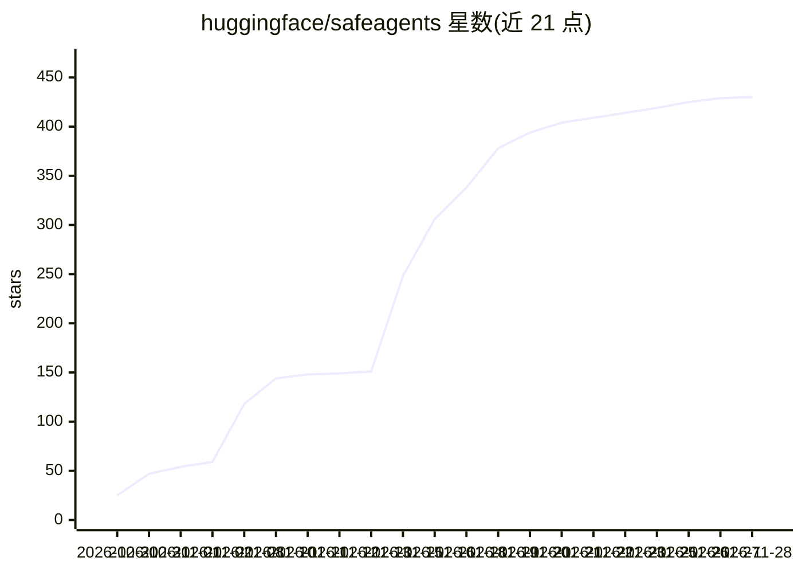

# huggingface/safeagents

⭐ 430 · Python · Apache-2.0 · 推送 2026-11-27 · [GitHub](https://github.com/huggingface/safeagents) · 组织维护

**给 coding agent 加本地代理：检查每个工具调用再放行**

运行在 agent 与模型服务器之间的本地代理：截获模型发出的每个工具调用，经三层检查（请求内声明校验、atif-scan 检测器、可选裁判模型裁决）后放行或替换为文本通知，使 harness 不执行被拦截的调用。通过设置 base URL 接入任意 harness，支持 OpenAI Chat Completions 与 Anthropic Messages 协议及流式输出。附带轨迹脱敏工具（凭据/邮箱/ home 目录检测）、Hugging Face 数据集发布功能与 661 条标注调用的裁判模型基准。Apache 2.0 许可。

## 筛选速览

| 维度 | 判定 | 备注 |
|---|---|---|
| AI 角色 | `ai-ecosystem` | LLM/agent 周边工具 |
| 许可风险 | `permissive` | Apache-2.0 |
| 部署形态 | `None` |  |
| 模型依赖 | — | README 未给出锁定关系 |
| 硬件要求 | — | 无带数字的原话,不猜 |
| 安装摩擦 | `low` | 无编译、无系统依赖或容器化 |
| 成熟度 | — | 结构信号不足 |

## 能力要点

- 三层检查机制：请求校验 + atif-scan 检测器 + 可选裁判模型
- --log-only 模式仅记录不拦截，便于先观察后启用
- 插件系统：本地 Python 文件或 hf:// 协议从 Hub 加载检测规则
- safeagents scrub 对轨迹文件做凭据/邮箱/路径脱敏

## 适用场景

- 运行 Claude Code 等编码 agent 时拦截危险工具调用
- 发布 agent 轨迹前批量脱敏凭据与个人信息
- 为 agent 选一个裁判模型做可疑调用二次判定

## 场景标签

`编码 Agent` `网络安全` `模型评测` · 领域:编码与开发

## 证据(README 行号)

> L3: A lightweight local proxy between your agent and its model server. It checks every tool call the model makes before 
> L41: `--log-only` only reports what it would block, which is a good way to start. Drop it to block for real. All command

## 星数曲线

2026-10-30 25 → 2026-11-28 430（+405）

---
*卡片 v1 · prompt 1.4 · 生成 2026-11-28 · 置信度 high · 依据 README sha `0618eaef48aa` · [字段定义](../../DATASET.md)*
