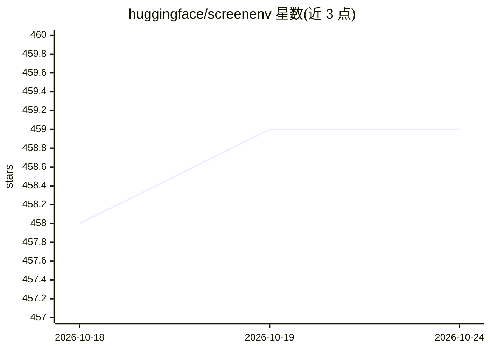

# huggingface/screenenv

⭐ 459 · Python · MIT · 推送 2026-09-24 · [GitHub](https://github.com/huggingface/screenenv) · 组织维护

**给开发者的 Docker 隔离桌面沙箱库，供 GUI 自动化与 AI 操控**

Hugging Face 出品的 Python 库，通过 Docker 容器提供沙箱化的 Ubuntu 22.04 + XFCE4 桌面环境，支持编程式鼠标键盘控制、窗口/文件/终端操作、Playwright 浏览器自动化、截屏与录屏。内置 MCP 服务器（30+ 自动化工具，Streamable HTTP 传输），可被任何 MCP 兼容的 AI/LLM 系统接入实现桌面自动化。运行需本机 Docker 与 Python 3.10+，建议 4GB 以上内存。

## 筛选速览

| 维度 | 判定 | 备注 |
|---|---|---|
| AI 角色 | `ai-ecosystem` | LLM/agent 周边工具 |
| 许可风险 | `permissive` | MIT |
| 部署形态 | `library` | 以包/库形式分发 |
| 模型依赖 | — | README 未给出锁定关系 |
| 硬件要求 | — | 无带数字的原话,不猜 |
| 安装摩擦 | `low` | 无编译、无系统依赖或容器化 |
| 成熟度 | — | 结构信号不足 |

## 能力要点

- Docker 容器内的隔离 Ubuntu 桌面环境（XFCE4/VNC/Chromium/LibreOffice）
- 编程式 GUI 自动化：鼠标、键盘、窗口、文件、终端与 Playwright 浏览器
- 内置 MCP 服务器，提供 30+ 桌面自动化工具
- 操作过程可录屏与截图

## 适用场景

- 为 AI agent 提供可安全操控的隔离桌面环境
- GUI 应用的自动化测试与演示录制
- 通过 MCP 接入任意兼容 AI 系统执行桌面任务

## 场景标签

`GUI 自动化` `浏览器自动化` · 领域:效率与自动化

## 证据(README 行号)

> L17: - 🤖 **MCP Server Support**: Model Context Protocol integration for AI/LLM automation
> L59: ScreenEnv includes full support for the Model Context Protocol (MCP), enabling seamless integration with AI/LLM sys
> L63: The Model Context Protocol (MCP) is a standard for AI assistants to interact with external tools and data sources. 

## 星数曲线

2026-10-18 458 → 2026-10-24 459（+1）

---
*卡片 v1 · prompt 1.4 · 生成 2026-10-21 · 置信度 high · 依据 README sha `13b76fddd262` · [字段定义](../../DATASET.md)*
