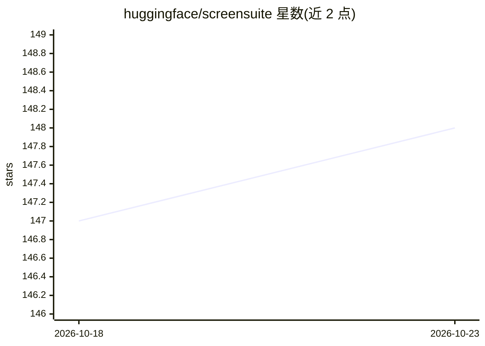

# huggingface/screensuite

⭐ 148 · Python · Apache-2.0 · 推送 2026-10-22 · [GitHub](https://github.com/huggingface/screensuite) · 组织维护

**GUI Agent 底层多模态模型的评测基准套件**

Hugging Face 维护的 GUI agent 评测套件，覆盖感知（ScreenSpot 系列）、单步离线（Multimodal-Mind2Web、AndroidControl）与多步在线（Mind2Web-Live、GAIA、OSWorld 等）三类基准，评测对象是驱动 agent 的多模态模型而非 agent 实现本身，agent 部分基于 smolagents 的简单实现。安装需 Docker、Python 3.11+ 与 uv，多步在线基准需 KVM 虚拟化（macOS 主机通常不支持），OSWorld Google 任务需自建 Google Cloud 项目。Apache 2.0 许可。

## 筛选速览

| 维度 | 判定 | 备注 |
|---|---|---|
| AI 角色 | `ai-ecosystem` | LLM/agent 周边工具 |
| 许可风险 | `permissive` | Apache-2.0 |
| 部署形态 | `None` |  |
| 模型依赖 | — | README 未给出锁定关系 |
| 硬件要求 | — | 无带数字的原话,不猜 |
| 安装摩擦 | `medium` | 含编译或系统依赖之一 |
| 成熟度 | — | 结构信号不足 |

## 能力要点

- 聚合感知/单步/多步三类 GUI agent 基准，覆盖 Web/Mobile/Desktop 平台
- 评测 MLLM 而非 agent 实现，agent 采用 smolagents 简单实现
- 多步在线基准通过 Docker 容器生成环境，依赖 KVM 虚拟化

## 适用场景

- 评估多模态模型在屏幕感知与点击定位上的能力
- 对比不同 MLLM 驱动 GUI agent 的多步任务成功率
- 为 GUI agent 研究选择底层模型提供基准数据

## 场景标签

`模型评测` · 领域:评测与运维

## 证据(README 行号)

> L3: A comprehensive benchmaring suite for evaluating Graphical User Interface (GUI) agents (i.e. agents that act on your
> L5: This does not aim to compare agent implementations, only the MLLMs that power them: thus we propose only simple agen

## 星数曲线

2026-10-18 147 → 2026-10-23 148（+1）

---
*卡片 v1 · prompt 1.4 · 生成 2026-10-22 · 置信度 high · 依据 README sha `80dad6701c4a` · [字段定义](../../DATASET.md)*
