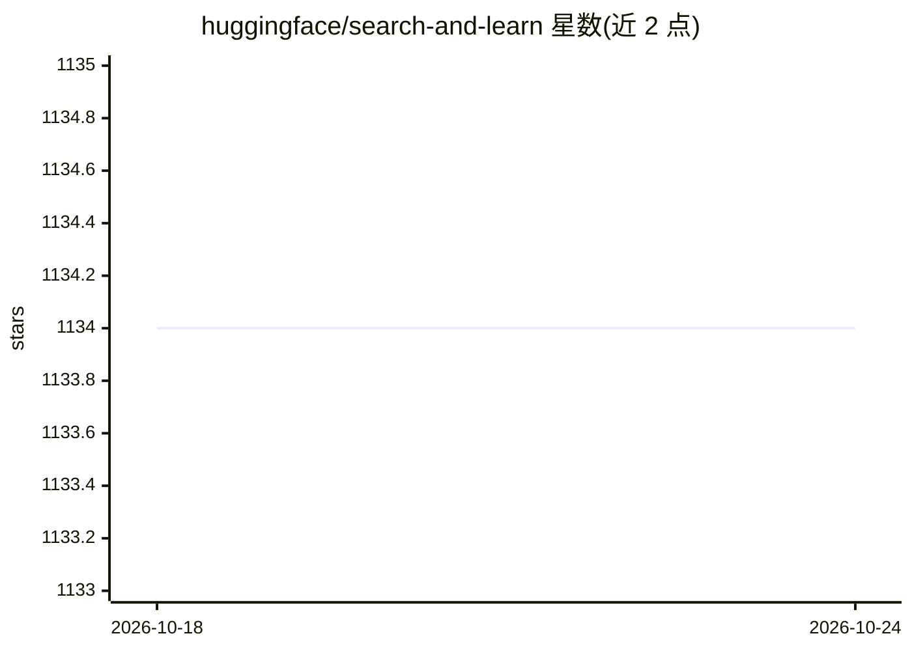

# huggingface/search-and-learn

⭐ 1,134 · Python · Apache-2.0 · 推送 2026-09-23 · [GitHub](https://github.com/huggingface/search-and-learn) · 组织维护

**开源 LLM 推理时算力扩展（test-time compute）方法配方集**

Hugging Face 团队维护的推理时算力扩展工具库：提供脚本与 YAML 配方，在测试时对开源模型应用搜索算法，支持 Best-of-N、beam search 与 DVTS（Diverse Verifier Tree Search）三种算法，使模型在难题上“思考更久”。用于复现其博客的 test-time compute 实验结果，基于 DeepMind 相关研究工作。安装需 Conda 环境、pip 安装、Hugging Face 登录与 Git LFS。

## 筛选速览

| 维度 | 判定 | 备注 |
|---|---|---|
| AI 角色 | `ai-ecosystem` | LLM/agent 周边工具 |
| 许可风险 | `permissive` | Apache-2.0 |
| 部署形态 | `library` | 以包/库形式分发 |
| 模型依赖 | — | README 未给出锁定关系 |
| 硬件要求 | — | 无带数字的原话,不猜 |
| 安装摩擦 | `low` | 无编译、无系统依赖或容器化 |
| 成熟度 | — | 结构信号不足 |

## 能力要点

- 支持 Best-of-N、beam search、DVTS 三种搜索算法
- 每个推理运行以 YAML 配方文件描述全部参数
- 提供复现 test-time compute 实验结果的脚本与配置

## 适用场景

- 复现 Hugging Face 的 test-time compute 实验结果
- 用搜索算法提升开源模型在数学/编码难题上的表现
- 研究推理时算力扩展策略

## 场景标签

`科研工具` · 领域:学习与行业

## 证据(README 行号)

> L6: Recipes to enhance LLM capabilities by scaling inference-time compute. Name inspired by Rich Sutton's Bitter Lesson:
> L25: * `recipes` to apply different search algorithms at test-time. Three algorithms are currently supported: Best-of-N,

## 星数曲线

2026-10-18 1,134 → 2026-10-24 1,134（+0）

---
*卡片 v1 · prompt 1.4 · 生成 2026-10-21 · 置信度 high · 依据 README sha `5e621e35b68e` · [字段定义](../../DATASET.md)*
