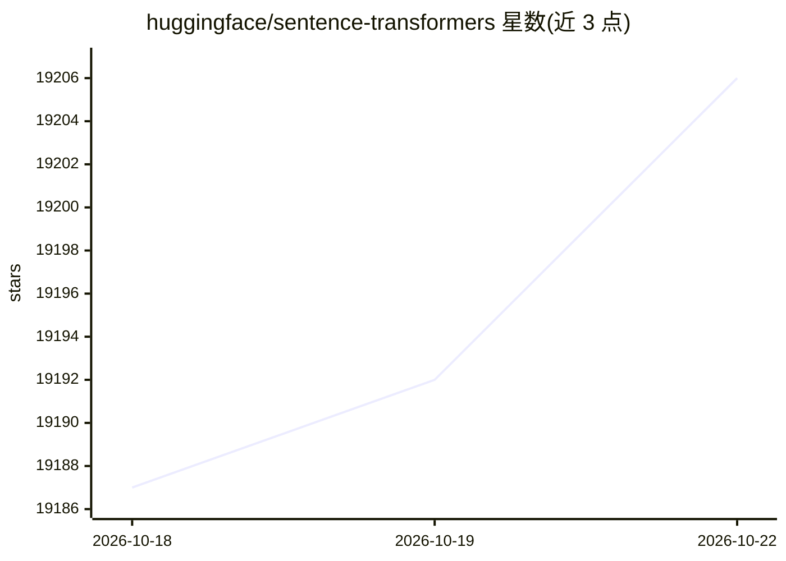

# huggingface/sentence-transformers

⭐ 19,210 · Python · Apache-2.0 · 推送 2026-10-22 · [GitHub](https://github.com/huggingface/sentence-transformers) · [官网](https://www.sbert.net) · 组织维护

**为开发者提供文本嵌入、检索与重排模型的训练和推理框架**

Python 框架，提供 SentenceTransformer、CrossEncoder、SparseEncoder、MultiVectorEncoder 四类模型的加载与推理 API，可计算嵌入、相似度分数、稀疏嵌入与 ColBERT 式 token 级嵌入。支持在自定义数据上微调嵌入/重排/稀疏模型，提供 20+ 损失函数、训练中评估、多语言与多任务学习。Hugging Face 上有超过 15,000 个预训练模型可直接使用，覆盖 100+ 语言。安装要求 Python 3.10+、PyTorch 2.2+、transformers v5.0+。

## 筛选速览

| 维度 | 判定 | 备注 |
|---|---|---|
| AI 角色 | `ai-ecosystem` | LLM/agent 周边工具 |
| 许可风险 | `permissive` | Apache-2.0 |
| 部署形态 | `library` | 以包/库形式分发 |
| 模型依赖 | — | README 未给出锁定关系 |
| 硬件要求 | — | 无带数字的原话,不猜 |
| 安装摩擦 | `medium` | 含编译或系统依赖之一 |
| 成熟度 | — | 结构信号不足 |

## 动量与使用信号

- 维护:`active` — 距上次 push 1.7 天,年发版 16,331 位贡献者
- 涨星:近 1 天 **+6**(自 20261016 起算)
- 安装:pypi 包 `sentence-transformers` 月下载 22,332,616

## 能力要点

- 四类模型支持：嵌入、重排（Cross-Encoder）、稀疏嵌入、多向量（ColBERT 式）检索
- 支持 BERT、RoBERTa、XLM-R、DistilBERT、Electra、BART 等骨干网络
- 20+ 嵌入损失函数、10+ 重排与稀疏损失函数，训练中自动评估选优
- 提供 Matryoshka 嵌入、静态嵌入训练、嵌入量化等效率技术文档

## 适用场景

- 为语义搜索和 RAG 管线计算文本稠密/稀疏嵌入
- 训练或微调面向特定任务的自定义嵌入模型
- 检索后用 Cross-Encoder 对候选段落重排
- 做语义文本相似度、聚类、复述挖掘等多语言应用

## 场景标签

`语义搜索` `微调` · 领域:知识与检索

## 证据(README 行号)

> L7: # Sentence Transformers: Embeddings, Retrieval, and Reranking
> L9: This framework provides an easy method to compute embeddings for accessing, using, and training state-of-the-art emb
> L141: - Support of various transformer networks including BERT, RoBERTa, XLM-R, DistilBERT, Electra, BART, ...

## 星数曲线

2026-10-18 19,187 → 2026-10-22 19,206（+19）

---
*卡片 v1 · prompt 1.4 · 生成 2026-10-18 · 置信度 high · 依据 README sha `5b9a33beb5d1` · [字段定义](../../DATASET.md)*
