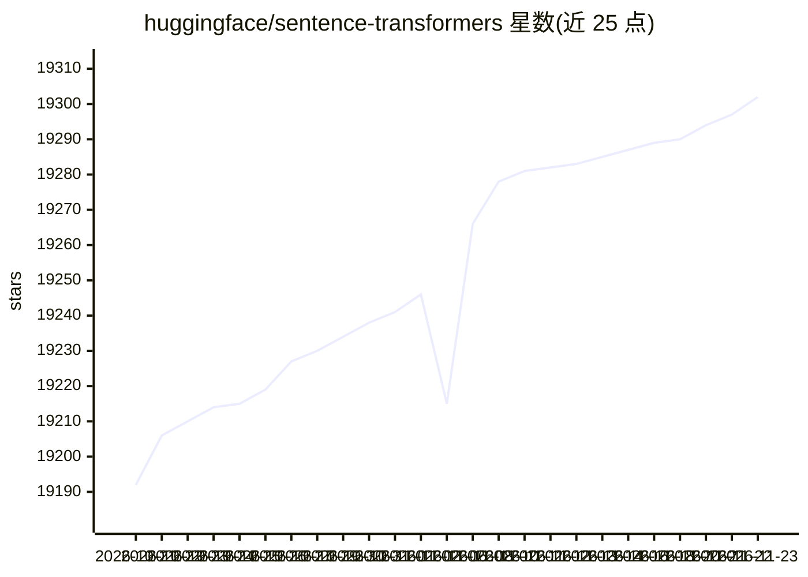

# huggingface/sentence-transformers

⭐ 19,302 · Python · Apache-2.0 · 推送 2026-11-20 · [GitHub](https://github.com/huggingface/sentence-transformers) · [官网](https://www.sbert.net) · 组织维护

**给开发者用的句子嵌入计算与训练框架**

Python 框架，提供计算嵌入、相似度打分、重排序、稀疏嵌入与 ColBERT 式多向量晚交互检索的统一 API；可加载 Hugging Face 上超过 15,000 个预训练模型，也支持微调自有嵌入/重排模型，含 20+ 嵌入损失函数与训练中评估。依赖 Python 3.10+、PyTorch 2.2+、transformers v5.0+，文档站点为 www.SBERT.net，另提供多模态（图像/音频/视频）extras。

## 筛选速览

| 维度 | 判定 | 备注 |
|---|---|---|
| AI 角色 | `ai-native` | 本体是模型或模型工具 |
| 许可风险 | `permissive` | Apache-2.0 |
| 部署形态 | `library` | 以包/库形式分发 |
| 模型依赖 | — | README 未给出锁定关系 |
| 硬件要求 | — | 无带数字的原话,不猜 |
| 安装摩擦 | `medium` | 含编译或系统依赖之一 |
| 成熟度 | — | 结构信号不足 |

## 动量与使用信号

- 维护:`active` — 距上次 push 1.7 天,年发版 16,331 位贡献者
- 涨星:近 1 天 **+6**(自 20261016 起算)
- 安装:pypi 包 `sentence-transformers` 月下载 22,332,616

## 能力要点

- 四类模型统一 API：SentenceTransformer、CrossEncoder、SparseEncoder、MultiVectorEncoder
- 可直接加载 Hugging Face 上 15,000+ 预训练模型，覆盖 100+ 语言
- 支持四种模型的微调训练，含 20+ 嵌入损失函数与训练中评估
- 提供 [image]/[audio]/[video]/[onnx]/[openvino] 等 extras

## 适用场景

- 为语义搜索和 RAG 管道计算文本嵌入
- 用 CrossEncoder 对检索结果做重排序
- 微调面向特定任务的嵌入模型
- 做句子相似度、聚类与复述挖掘

## 场景标签

`语义搜索` `微调` · 领域:知识与检索

## 证据(README 行号)

> L9: This framework provides an easy method to compute embeddings for accessing, using, and training state-of-the-art emb
> L11: A wide selection of over 15,000 pre-trained Sentence Transformers models are available for immediate use on 🤗 Huggi
> L20: pip install -U sentence-transformers

## 星数曲线

2026-10-21 19,192 → 2026-11-23 19,302（+110）

---
*卡片 v1 · prompt 1.4 · 生成 2026-11-22 · 置信度 high · 依据 README sha `3e73f18d01b7` · [字段定义](../../DATASET.md)*
