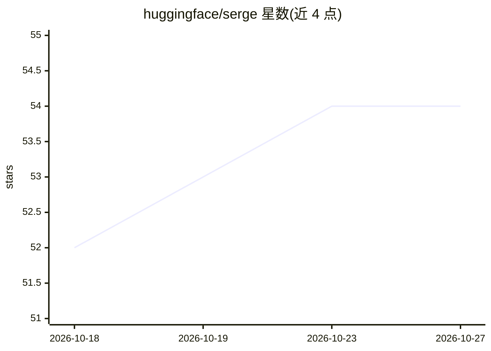

# huggingface/serge

⭐ 54 · Python · Apache-2.0 · 推送 2026-10-26 · [GitHub](https://github.com/huggingface/serge) · [官网](https://huggingface.github.io/serge/) · 组织维护

**用 OpenAI 兼容 LLM 审查 GitHub PR 的评审机器人**

serge 是 Hugging Face 维护的 GitHub 评审机器人：调用任意 OpenAI 兼容的 LLM 对 pull request 生成经过校验的 diff 行内评论，默认角色为 Serge，通过 `@askserge please review` 等评论触发。提供三种运行模式：GitHub Action（按仓库 CI 控制）、GitHub App webhook（跨仓库托管自动化）、Web 应用（人审后发布的分阶段评审）。此外可从 CI 失败开启修复 PR 的可选写权限任务流。配置需将 LLM key 设为仓库 secret `LLM_API_KEY`。

## 筛选速览

| 维度 | 判定 | 备注 |
|---|---|---|
| AI 角色 | `ai-native` | 本体是模型或模型工具 |
| 许可风险 | `permissive` | Apache-2.0 |
| 部署形态 | `None` |  |
| 模型依赖 | — | README 未给出锁定关系 |
| 硬件要求 | — | 无带数字的原话,不猜 |
| 安装摩擦 | `low` | 无编译、无系统依赖或容器化 |
| 成熟度 | — | 结构信号不足 |

## 能力要点

- 调用任意 OpenAI 兼容 LLM 对 PR diff 生成行内评论
- 三种运行模式：GitHub Action / GitHub App webhook / Web 应用
- `@askserge please review` 评论触发评审
- 可选写权限任务流：从 CI 失败自动开修复 PR

## 适用场景

- 在 CI 中自动评审 pull request 的代码改动
- 跨多仓库托管自动化 LLM 评审
- 先人审再发布评审评论的分阶段流程

## 场景标签

`代码审查` · 领域:编码与开发

## 证据(README 行号)

> L3: `serge` reviews GitHub pull requests with an OpenAI-compatible LLM and
> L4: posts validated inline comments on the diff. The default reviewer persona is

## 星数曲线

2026-10-18 52 → 2026-10-27 54（+2）

---
*卡片 v1 · prompt 1.4 · 生成 2026-10-24 · 置信度 high · 依据 README sha `69a6dd2f3bb0` · [字段定义](../../DATASET.md)*
