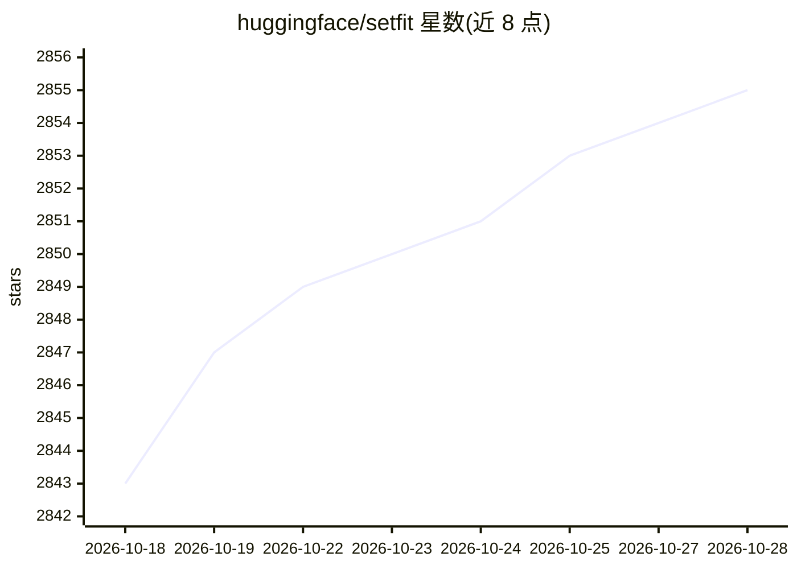

# huggingface/setfit

⭐ 2,855 · Jupyter Notebook · Apache-2.0 · 推送 2026-10-06 · [GitHub](https://github.com/huggingface/setfit) · [官网](https://hf.co/docs/setfit) · 组织维护

**Sentence Transformers 少样本微调框架，无需提示词**

Hugging Face 维护的少样本微调框架：基于 Sentence Transformers 生成文本嵌入，配合 scikit-learn 或可微分的 SetFitHead 分类头完成分类任务，训练无需手工提示词或 verbalizer，也不依赖 T0/GPT-3 级大模型。提供 SetFitModel 与 Trainer 两个核心类，与 Hugging Face Hub 集成，可用任意 Hub 上的多语言 Sentence Transformer 检查点。以 pip 包分发，并提供论文结果复现脚本与开发环境配置说明。

## 筛选速览

| 维度 | 判定 | 备注 |
|---|---|---|
| AI 角色 | `ai-ecosystem` | LLM/agent 周边工具 |
| 许可风险 | `permissive` | Apache-2.0 |
| 部署形态 | `library` | 以包/库形式分发 |
| 模型依赖 | — | README 未给出锁定关系 |
| 硬件要求 | — | 无带数字的原话,不猜 |
| 安装摩擦 | `low` | 无编译、无系统依赖或容器化 |
| 成熟度 | — | 结构信号不足 |

## 能力要点

- 基于嵌入的少样本微调，无需提示词与 verbalizer
- SetFitModel 组合 sentence_transformers 预训练主体与 scikit-learn/SetFitHead 分类头
- 支持任意 Hub 上的多语言 Sentence Transformer 检查点
- 提供论文结果复现脚本

## 适用场景

- 标注数据极少（如每类 8 条）时训练文本分类模型
- 多语言文本分类任务的少样本微调
- 复现 SetFit 论文中的对比实验结果

## 场景标签

`微调` · 领域:训练与推理

## 证据(README 行号)

> L5: SetFit is an efficient and prompt-free framework for few-shot fine-tuning of Sentence Transformers. It achieves high
> L39: * `SetFitModel`: a wrapper that combines a pretrained body from `sentence_transformers` and a classification head f

## 星数曲线

2026-10-18 2,843 → 2026-10-28 2,855（+12）

---
*卡片 v1 · prompt 1.4 · 生成 2026-10-21 · 置信度 high · 依据 README sha `53ebec4a81c6` · [字段定义](../../DATASET.md)*
