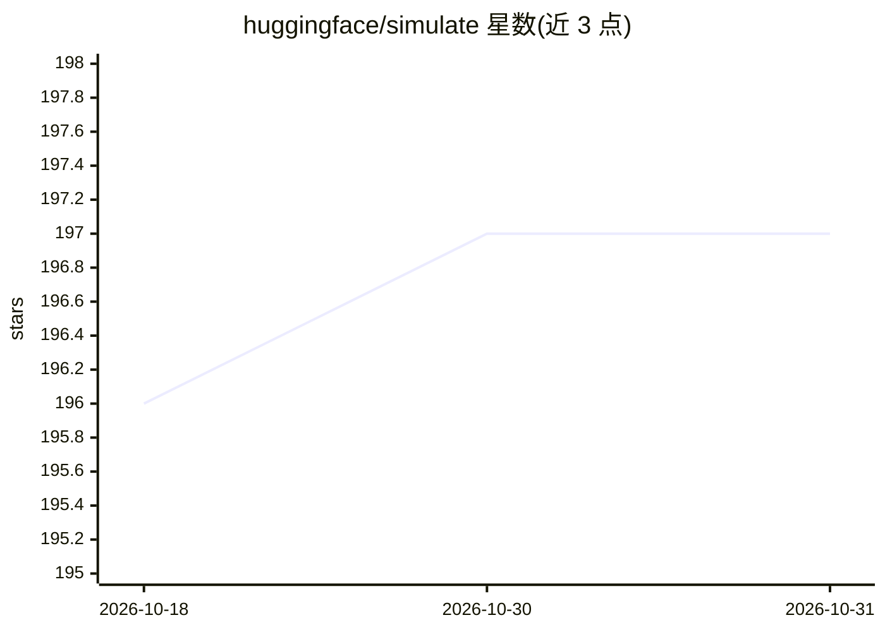

# huggingface/simulate

⭐ 197 · Python · Apache-2.0 · 推送 2026-10-14 · [GitHub](https://github.com/huggingface/simulate) · [官网](https://huggingface.co/docs/simulate) · 组织维护

**创建与共享智能体仿真环境的 Python 库**

Hugging Face 维护的 Python 库，用于创建、保存和共享面向智能体（如强化学习）训练或合成数据生成的仿真环境。用户通过 Python API 创建 Scene 并添加对象（网格/材质/相机/光照），默认 pyvista/vtk 后端可快速渲染，设置 engine="unity" 可运行物理仿真（自动下载 Unity 构建），Godot 与 Blender 后端在计划中。场景以引擎无关的 glTF 格式保存，可从本地或 Hub 加载。README 明确声明该库不再积极维护。

## 筛选速览

| 维度 | 判定 | 备注 |
|---|---|---|
| AI 角色 | `ai-ecosystem` | LLM/agent 周边工具 |
| 许可风险 | `permissive` | Apache-2.0 |
| 部署形态 | `library` | 以包/库形式分发 |
| 模型依赖 | — | README 未给出锁定关系 |
| 硬件要求 | — | 无带数字的原话,不猜 |
| 安装摩擦 | `low` | 无编译、无系统依赖或容器化 |
| 成熟度 | — | 结构信号不足 |

## 能力要点

- Python API 创建/编辑场景与 3D 对象（对象以树结构组织）
- 默认 pyvista/vtk 后端渲染，Unity 后端支持物理仿真
- 场景以 glTF 引擎无关格式保存，支持与 Hugging Face Hub 互传

## 适用场景

- 为强化学习智能体搭建 3D 仿真环境
- 生成合成数据的研究场景构建
- 在 Hub 上共享和复用仿真场景文件

## 场景标签

`强化学习` · 领域:训练与推理

## 证据(README 行号)

> L15: Simulate is a library for easily creating and sharing simulation environments for intelligent agents (e.g. reinforc
> L40: You can also render the scene or do simulations using one of the backend rendering/simulation engines (at the momen

## 星数曲线

2026-10-18 196 → 2026-10-31 197（+1）

---
*卡片 v1 · prompt 1.4 · 生成 2026-10-22 · 置信度 high · 依据 README sha `8dddfc1cb13a` · [字段定义](../../DATASET.md)*
