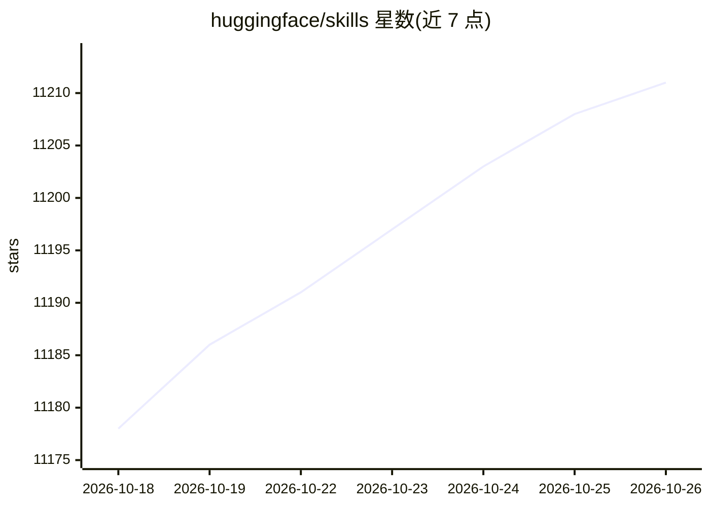

# huggingface/skills

⭐ 11,211 · Python · Apache-2.0 · 推送 2026-10-23 · [GitHub](https://github.com/huggingface/skills) · [官网](https://huggingface.co) · 组织维护

**给 AI 编程代理接入 Hugging Face 生态的技能包仓库**

由 Hugging Face 维护的 Agent Skills 仓库：以标准化 SKILL.md 文件夹格式提供 20 余个技能，覆盖 Hub 操作（hf-cli 引导技能）、模型选择、数据集操作、训练微调（TRL/Unsloth/sentence-transformers）、评测、Spaces 部署、SageMaker 云部署规划等。客户端市场仅暴露 hf-cli，其余技能通过 `hf skills add` 安装或经 CLI/MCP 发现。兼容 Claude Code、Codex、Gemini CLI、Cursor 四类编码代理，另提供 AGENTS.md 回退方案。

## 筛选速览

| 维度 | 判定 | 备注 |
|---|---|---|
| AI 角色 | `ai-ecosystem` | LLM/agent 周边工具 |
| 许可风险 | `permissive` | Apache-2.0 |
| 部署形态 | `None` |  |
| 模型依赖 | — | README 未给出锁定关系 |
| 硬件要求 | — | 无带数字的原话,不猜 |
| 安装摩擦 | `medium` | 含编译或系统依赖之一 |
| 成熟度 | — | 结构信号不足 |

## 能力要点

- 20 余个标准化 SKILL.md 技能，覆盖 Hub 操作、训练、评测、部署
- hf-cli 为引导技能，由本地安装的 CLI 生成以保持最新
- 兼容 Claude Code、Codex、Gemini CLI、Cursor 四类客户端
- 技能可经 CLI/MCP 集成被技能感知客户端动态发现

## 适用场景

- 让编码代理用自然语言调用 hf 命令管理模型与数据集
- 为代理配置 Hugging Face 模型选择、训练与评测工作流
- 通过 hf skills add 按需扩展代理的 HF 生态能力

## 场景标签

`提示工程` · 领域:Agent 开发

## 证据(README 行号)

> L3: Hugging Face Skills are definitions for AI/ML tasks like dataset creation, model training, and evaluation. The clien
> L12: In practice, skills are self-contained folders that package instructions, scripts, and resources together for an AI
> L23: Hugging Face skills are compatible with Claude Code, Codex, Gemini CLI, and Cursor.

## 星数曲线

2026-10-18 11,178 → 2026-10-26 11,211（+33）

---
*卡片 v1 · prompt 1.4 · 生成 2026-10-20 · 置信度 high · 依据 README sha `7a0774411f29` · [字段定义](../../DATASET.md)*
