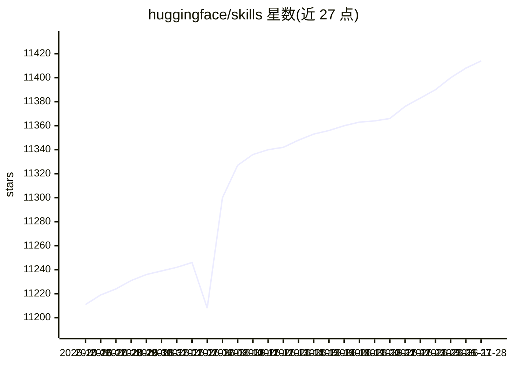

# huggingface/skills

⭐ 11,414 · Python · Apache-2.0 · 推送 2026-11-26 · [GitHub](https://github.com/huggingface/skills) · [官网](https://huggingface.co) · 组织维护

**给编码 agent 提供 Hugging Face 生态操作技能的仓库**

以标准 Agent Skills 格式打包的技能定义仓库：每个技能是一个含 SKILL.md 的自包含文件夹，向 AI agent 提供指令与脚本。入口技能 hf-cli 覆盖 Hub 全部 CLI 操作（搜索模型、管理数据集、启动 Spaces、运行任务），由本地安装的 CLI 生成以保持更新；另有 SageMaker 部署、GPU 内存估算、LoRA demo 构建、sentence-transformers/TRL 训练等约 20 个工作流技能。兼容 Claude Code、Codex、Gemini CLI、Cursor，客户端 marketplace 仅暴露 hf-cli，其余技能用 hf skills add 按需安装。

## 筛选速览

| 维度 | 判定 | 备注 |
|---|---|---|
| AI 角色 | `ai-knowledge` | 知识聚合/清单类 |
| 许可风险 | `permissive` | Apache-2.0 |
| 部署形态 | `None` |  |
| 模型依赖 | — | README 未给出锁定关系 |
| 硬件要求 | — | 无带数字的原话,不猜 |
| 安装摩擦 | `low` | 无编译、无系统依赖或容器化 |
| 成熟度 | — | 结构信号不足 |

## 能力要点

- hf-cli 技能由本地 CLI 生成，覆盖全部 Hub 操作
- 遵循标准化 Agent Skills 格式，含 SKILL.md 与配套脚本
- 官方分发渠道覆盖 Claude Code、Codex、Gemini CLI、Cursor 四类客户端
- 支持通过 hf skills add/list/update 按需安装与更新技能

## 适用场景

- 让编码 agent 直接搜索、下载和管理 Hugging Face 上的模型与数据集
- 通过技能指引 agent 规划并部署模型到 SageMaker
- 让 agent 估算模型显存占用或编写 SFT/LoRA 训练脚本
- 为自研 agent 贡献或定制 HF 生态技能

## 场景标签

`编码 Agent` `提示工程` · 领域:Agent 开发

## 证据(README 行号)

> L3: Hugging Face Skills are definitions for AI/ML tasks like dataset creation, model training, and evaluation. The clien
> L5: The skills in this repository follow the standardized Agent Skills format.
> L12: In practice, skills are self-contained folders that package instructions, scripts, and resources together for an AI

## 星数曲线

2026-10-26 11,211 → 2026-11-28 11,414（+203）

---
*卡片 v1 · prompt 1.4 · 生成 2026-11-27 · 置信度 high · 依据 README sha `2b5589e542b2` · [字段定义](../../DATASET.md)*
