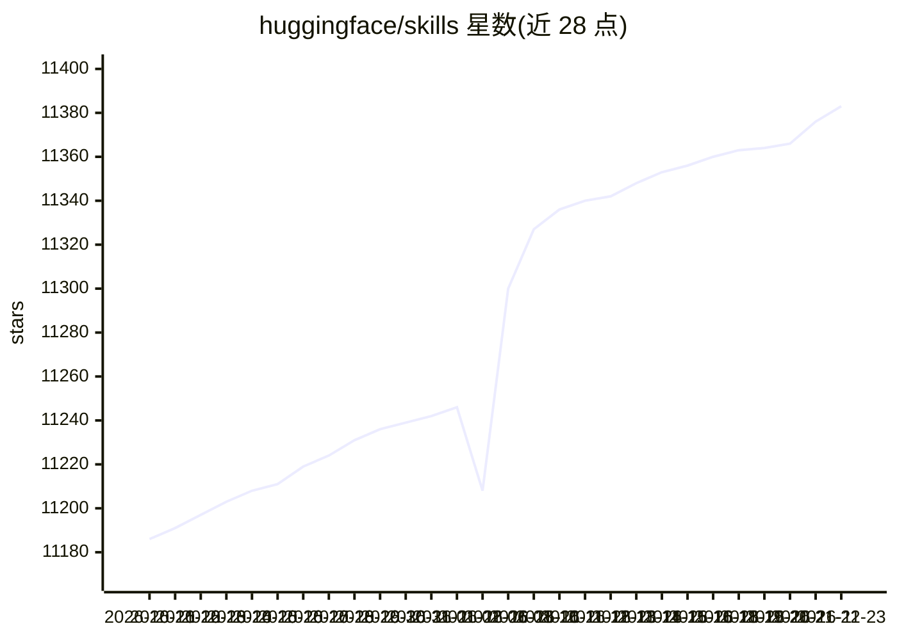

# huggingface/skills

⭐ 11,383 · Python · Apache-2.0 · 推送 2026-11-20 · [GitHub](https://github.com/huggingface/skills) · [官网](https://huggingface.co) · 组织维护

**为 AI agent 提供的 Hugging Face 生态技能定义集合**

以标准 Agent Skills 格式（SKILL.md + YAML frontmatter）定义 AI/ML 任务技能，覆盖数据集创建、模型训练、评估、部署到 SageMaker、论文管理等场景。核心入口为 hf-cli 技能，教会 agent 使用全部 hf 命令操作 Hub。兼容 Claude Code、Codex、Gemini CLI、Cursor 四类客户端，通过插件市场注册、extensions 安装、symlink 或 hf skills add 方式分发；不支持技能的 agent 可回退使用 AGENTS.md。贡献者可用 publish.sh 重新生成清单。

## 筛选速览

| 维度 | 判定 | 备注 |
|---|---|---|
| AI 角色 | `ai-knowledge` | 知识聚合/清单类 |
| 许可风险 | `permissive` | Apache-2.0 |
| 部署形态 | `None` |  |
| 模型依赖 | — | README 未给出锁定关系 |
| 硬件要求 | — | 无带数字的原话,不猜 |
| 安装摩擦 | `medium` | 含编译或系统依赖之一 |
| 成熟度 | — | 结构信号不足 |

## 能力要点

- hf-cli 技能从本地安装的 CLI 生成，覆盖全部 hf 命令
- 24 个技能覆盖训练、评估、部署、论文、Spaces 等任务
- 兼容 Claude Code/Codex/Gemini CLI/Cursor 四类客户端
- 提供 AGENTS.md 作为不支持技能的 agent 的回退

## 适用场景

- 让编码 agent 直接搜索和管理 Hub 上的模型与数据集
- 通过 agent 在 SageMaker 上规划并部署模型
- 用 agent 估算模型所需 GPU 内存或运行评估
- 训练或微调语言与视觉模型

## 场景标签

`编码 Agent` `微调` `模型训练` `模型评测` · 领域:编码与开发

## 证据(README 行号)

> L3: Hugging Face Skills are definitions for AI/ML tasks like dataset creation, model training, and evaluation. The clien
> L5: The skills in this repository follow the standardized Agent Skills format.

## 星数曲线

2026-10-21 11,186 → 2026-11-23 11,383（+197）

---
*卡片 v1 · prompt 1.4 · 生成 2026-11-22 · 置信度 high · 依据 README sha `dc55d23c0a82` · [字段定义](../../DATASET.md)*
