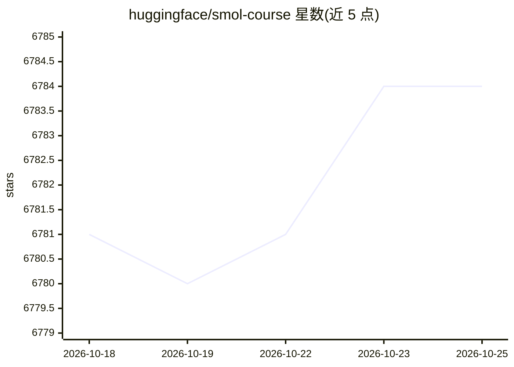

# huggingface/smol-course

⭐ 6,784 · Jupyter Notebook · Apache-2.0 · 推送 2026-10-06 · [GitHub](https://github.com/huggingface/smol-course) · 组织维护

**面向本地机器的小语言模型对齐实战课程**

Hugging Face 维护的开放、同行评审的实践课程，讲授如何在特定用途上对齐语言模型：从指令微调、评测、偏好对齐（DPO）到视觉语言模型、强化学习与合成数据共 7 个章节。课程围绕 SmolLM3 与 SmolVLM2 模型构建，大多可在本地机器运行，GPU 要求低且无需付费服务；技能也可迁移到更大的模型。先修要求为了解 ML/NLP、Python、PyTorch 与 transformers 库。v2 课程即将迁移至 Hugging Face Learn 重新发布。

## 筛选速览

| 维度 | 判定 | 备注 |
|---|---|---|
| AI 角色 | `ai-knowledge` | 知识聚合/清单类 |
| 许可风险 | `permissive` | Apache-2.0 |
| 部署形态 | `None` |  |
| 模型依赖 | — | README 未给出锁定关系 |
| 硬件要求 | — | 无带数字的原话,不猜 |
| 安装摩擦 | `low` | 无编译、无系统依赖或容器化 |
| 成熟度 | — | 结构信号不足 |

## 能力要点

- 7 章实操课程：指令微调、评测、DPO 偏好对齐、VLM、强化学习、合成数据
- 围绕 SmolLM3/SmolVLM2，技能可迁移到其他小模型或更大模型
- 本地机器可运行，最低 GPU 要求且无需付费服务
- 开放同行评审：通过 PR 提交作业并参与排行榜

## 适用场景

- 学习如何在本地微调和对齐小语言模型
- 为特定领域定制专属小模型并部署
- 通过课程作业与排行榜参与社区共建

## 场景标签

`教程课程` `微调` · 领域:学习与行业

## 证据(README 行号)

> L5: This is a practical course on aligning language models for your specific use case. It's a handy way to get started w
> L27: This course provides a practical, hands-on approach to working with small language models, from initial training th

## 星数曲线

2026-10-18 6,781 → 2026-10-25 6,784（+3）

---
*卡片 v1 · prompt 1.4 · 生成 2026-10-20 · 置信度 high · 依据 README sha `dbb2055e9336` · [字段定义](../../DATASET.md)*
