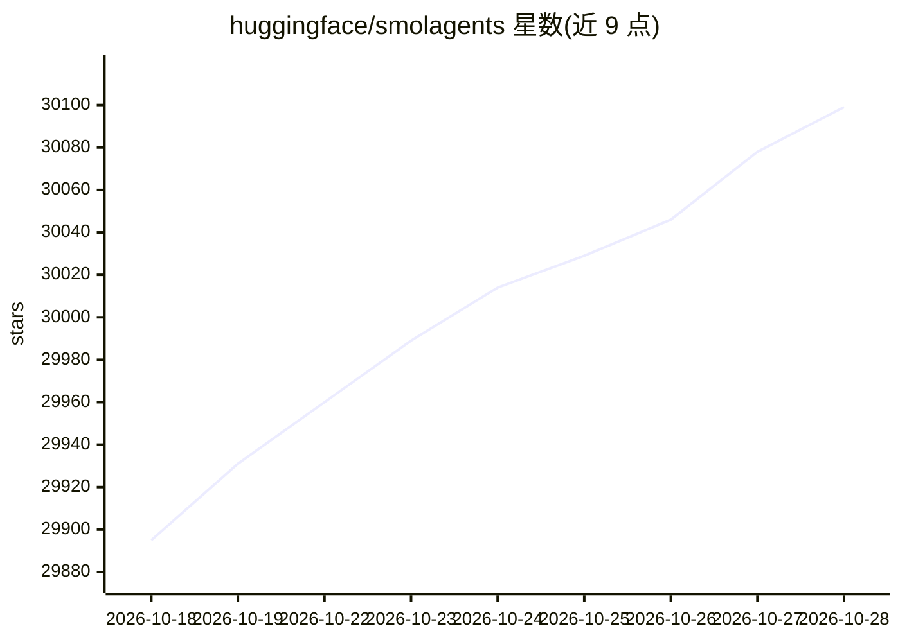

# huggingface/smolagents

⭐ 30,099 · Python · Apache-2.0 · 推送 2026-10-22 · [GitHub](https://github.com/huggingface/smolagents) · [官网](https://huggingface.co/docs/smolagents) · 组织维护

**面向开发者的极简 Agent 库：以代码片段作为行动形式**

Hugging Face 维护的 Python Agent 库，核心是 CodeAgent——LLM 以 Python 代码片段形式书写动作并执行，另提供基于 JSON/文本工具调用的 ToolCallingAgent 与多 Agent 层级。模型侧通过 InferenceClientModel、LiteLLMModel、OpenAIModel、TransformersModel、AzureOpenAIModel、AmazonBedrockModel 等封装接入多类推理来源；工具可来自 MCP 服务器或 LangChain，Agent/工具可经 Hub 分享。代码执行存在安全风险，需在 E2B/Blaxel/Modal/Docker 等沙箱中运行，内置 LocalPythonExecutor 不构成安全边界。

## 筛选速览

| 维度 | 判定 | 备注 |
|---|---|---|
| AI 角色 | `ai-native` | 本体是模型或模型工具 |
| 许可风险 | `permissive` | Apache-2.0 |
| 部署形态 | `library` | 以包/库形式分发 |
| 模型依赖 | locked-api |  |
| 硬件要求 | — | 无带数字的原话,不猜 |
| 安装摩擦 | `low` | 无编译、无系统依赖或容器化 |
| 成熟度 | — | 结构信号不足 |

## 动量与使用信号

- 维护:`active` — 距上次 push 11.6 天,年发版 4,203 位贡献者
- 涨星:近 1 天 **+20**(自 20261016 起算)
- 平台:— · 协议:OPENAI-API / MCP / OLLAMA

## 能力要点

- CodeAgent 以 Python 代码片段作为动作形式，agents.py 主代码约 1,000 行
- 支持 E2B、Blaxel、Modal、Docker 沙箱执行与本地 LocalPythonExecutor
- 模型来源可换：transformers/ollama 本地模型、Hub 提供商、LiteLLM、OpenAI 兼容服务、Azure、Bedrock
- 提供 smolagent/webagent 两个 CLI 命令与 Hub 上的 Agent/工具分享

## 适用场景

- 让 Agent 以代码形式执行多步工具调用任务
- 通过 CLI 快速运行网页浏览类 Agent
- 在 Hub 上分享和复用他人构建的 Agent 与工具

## 场景标签

`Agent 框架` `浏览器自动化` · 领域:Agent 开发

## 证据(README 行号)

> L10: `smolagents` is a library that enables you to run powerful agents in a few lines of code. It offers:
> L14: 🧑‍💻 **First-class support for Code Agents**. Our `CodeAgent` writes its actions in code (as opposed to "agents bein
> L18: 🌐 **Model-agnostic**: smolagents supports any LLM. It can be a local `transformers` or `ollama` model, one of many 

## 星数曲线

2026-10-18 29,895 → 2026-10-28 30,099（+204）

---
*卡片 v1 · prompt 1.4 · 生成 2026-10-18 · 置信度 high · 依据 README sha `0f04c0e97a87` · [字段定义](../../DATASET.md)*
