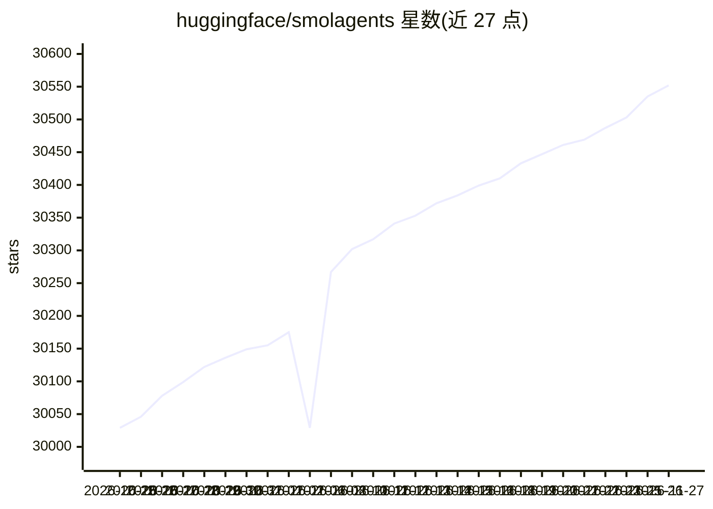

# huggingface/smolagents

⭐ 30,552 · Python · Apache-2.0 · 推送 2026-11-26 · [GitHub](https://github.com/huggingface/smolagents) · [官网](https://huggingface.co/docs/smolagents) · 组织维护

**让开发者用少量代码构建以代码思考的 agent 的库**

smolagents 是 Hugging Face 出品的 agent 构建库，核心逻辑约 1,000 行 Python。提供 CodeAgent（以 Python 代码片段写动作）与 ToolCallingAgent（JSON 工具调用）两种 agent 类型，支持多 agent 层级、MCP/LangChain/Hub Space 工具接入及文本/视觉/视频/音频输入。模型无关：可接 HF Hub 推理、ollama、llama.cpp 本地模型，或经 LiteLLM/OpenAI 兼容接口使用多家服务商。附带 smolagent/webagent 两个 CLI。安全方面明确声明内置 LocalPythonExecutor 不是安全沙箱，需用 E2B/Docker 等沙箱执行代码。

## 筛选速览

| 维度 | 判定 | 备注 |
|---|---|---|
| AI 角色 | `ai-ecosystem` | LLM/agent 周边工具 |
| 许可风险 | `permissive` | Apache-2.0 |
| 部署形态 | `library` | 以包/库形式分发 |
| 模型依赖 | local-ok | 支持本地模型 |
| 硬件要求 | — | 无带数字的原话,不猜 |
| 安装摩擦 | `low` | 无编译、无系统依赖或容器化 |
| 成熟度 | — | 结构信号不足 |

## 动量与使用信号

- 维护:`active` — 距上次 push 11.6 天,年发版 4,203 位贡献者
- 涨星:近 1 天 **+20**(自 20261016 起算)
- 平台:— · 协议:OPENAI-API / MCP / OLLAMA

## 能力要点

- CodeAgent 以 Python 代码片段作为动作，README 称可减少约 30% 步骤
- 模型无关：支持 HF Hub、ollama、llama.cpp、LiteLLM、OpenAI 兼容服务器等
- 支持 E2B/Blaxel/Modal/Docker 沙箱执行，并警示本地执行器非安全边界
- 工具可来自任意 MCP 服务器、LangChain 或 Hub Space

## 适用场景

- 用几行代码构建能执行网页搜索等工具调用的 agent
- 搭建基于本地开源模型的代码型 agent 工作流
- 通过 CLI 运行网页浏览类自动化任务
- 将 agent 分享到 Hugging Face Hub 供他人复用

## 场景标签

`Agent 框架` `多智能体` `浏览器自动化` · 领域:Agent 开发

## 证据(README 行号)

> L10: `smolagents` is a library that enables you to run powerful agents in a few lines of code. It offers:
> L14: 🧑‍💻 **First-class support for Code Agents**. Our `CodeAgent` writes its actions in code (as opposed to "agents bein
> L18: 🌐 **Model-agnostic**: smolagents supports any LLM. It can be a local `transformers` or `ollama` model, one of many 

## 星数曲线

2026-10-25 30,029 → 2026-11-27 30,552（+523）

---
*卡片 v1 · prompt 1.4 · 生成 2026-11-27 · 置信度 high · 依据 README sha `feac7f55eb56` · [字段定义](../../DATASET.md)*
