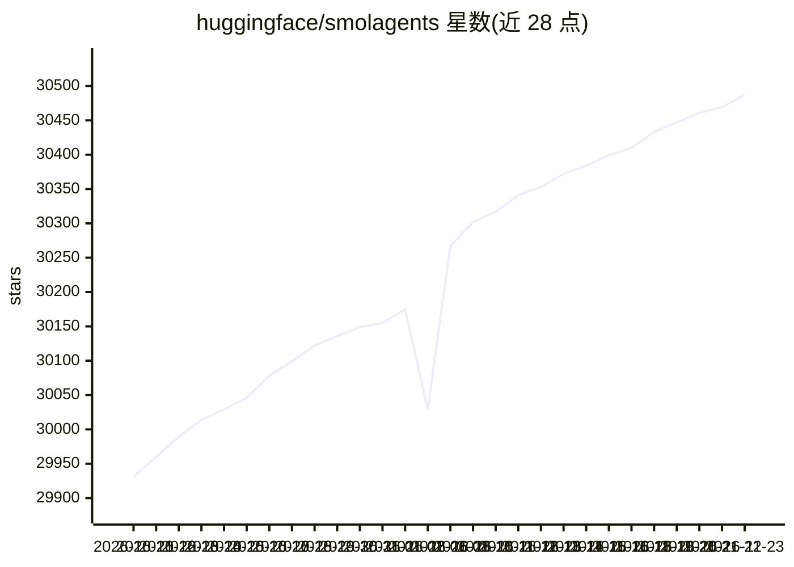

# huggingface/smolagents

⭐ 30,487 · Python · Apache-2.0 · 推送 2026-11-20 · [GitHub](https://github.com/huggingface/smolagents) · [官网](https://huggingface.co/docs/smolagents) · 组织维护

**以代码动作构建 LLM Agent 的轻量 Python 库**

smolagents 是 Hugging Face 提供的 Agent 构建库，核心机制为 CodeAgent：LLM 以 Python 代码片段形式写入动作而非 JSON 工具调用，另提供 ToolCallingAgent、多 Agent 层级与视觉输入支持。模型接入方式模型无关，覆盖 Hub 推理、LiteLLM、OpenAI 兼容服务器、transformers、llama.cpp、Azure、Bedrock。代码执行支持 E2B、Blaxel、Modal、Docker 沙箱；内置 LocalPythonExecutor 被声明为非安全边界。提供 pip 安装与 smolagent/webagent 命令行工具，代理/工具可分享至 Hub。

## 筛选速览

| 维度 | 判定 | 备注 |
|---|---|---|
| AI 角色 | `ai-ecosystem` | LLM/agent 周边工具 |
| 许可风险 | `permissive` | Apache-2.0 |
| 部署形态 | `library` | 以包/库形式分发 |
| 模型依赖 | local-ok | 支持本地模型 |
| 硬件要求 | — | 无带数字的原话,不猜 |
| 安装摩擦 | `low` | 无编译、无系统依赖或容器化 |
| 成熟度 | — | 结构信号不足 |

## 动量与使用信号

- 维护:`active` — 距上次 push 11.6 天,年发版 4,203 位贡献者
- 涨星:近 1 天 **+20**(自 20261016 起算)
- 平台:— · 协议:OPENAI-API / MCP / OLLAMA

## 能力要点

- CodeAgent 以 Python 代码片段执行动作，README 称减少约 30% 步数
- 支持 E2B/Blaxel/Modal/Docker 沙箱执行，并警告 LocalPythonExecutor 非安全边界
- 模型无关：Hub 推理、LiteLLM、OpenAI 兼容、transformers、llama.cpp 等
- CLI 命令 smolagent 与 webagent，支持交互式配置向导

## 适用场景

- 几行代码搭建可执行代码动作的 LLM Agent
- 需要沙箱隔离运行不可信 Agent 代码的场景
- 接入多种模型提供商（云端或本地）运行 Agent 工作流
- 将 Agent 或工具分享到 Hugging Face Hub

## 场景标签

`Agent 框架` · 领域:Agent 开发

## 证据(README 行号)

> L10: `smolagents` is a library that enables you to run powerful agents in a few lines of code. It offers:
> L14: 🧑‍💻 **First-class support for Code Agents**. Our `CodeAgent` writes its actions in code (as opposed to "agents bein
> L18: 🌐 **Model-agnostic**: smolagents supports any LLM. It can be a local `transformers` or `ollama` model, one of many 

## 星数曲线

2026-10-21 29,931 → 2026-11-23 30,487（+556）

---
*卡片 v1 · prompt 1.4 · 生成 2026-11-22 · 置信度 high · 依据 README sha `40d57d87bd29` · [字段定义](../../DATASET.md)*
