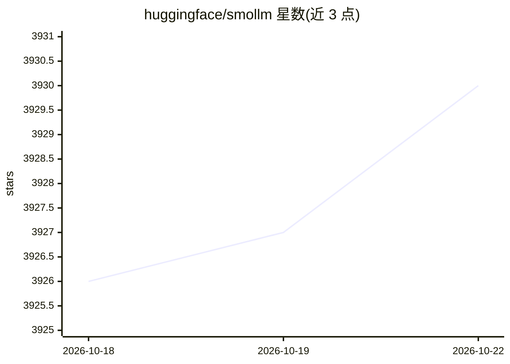

# huggingface/smollm

⭐ 3,931 · Python · Apache-2.0 · 推送 2026-10-06 · [GitHub](https://github.com/huggingface/smollm) · [官网](https://huggingface.co/HuggingFaceTB) · 组织维护

**HuggingFace 的轻量级开源文本与视觉模型家族（SmolLM/SmolVLM）**

HuggingFace 团队维护的 SmolLM 与 SmolVLM 模型家族仓库：SmolLM3 为 3B 参数文本模型，在 11T token 公开数据上训练，支持双模式推理（think/no_think）、6 种语言、最长 128k 上下文（NoPE+YaRN）；SmolVLM 为紧凑多模态模型，可处理图像文本输入完成视觉问答、图像描述等任务并支持单轮对话多图，可在设备端运行。仓库开放权重并公开数据混合配比与训练配置，附 transformers 加载示例、本地推理指南及预训练数据集链接。

## 筛选速览

| 维度 | 判定 | 备注 |
|---|---|---|
| AI 角色 | `ai-native` | 本体是模型或模型工具 |
| 许可风险 | `permissive` | Apache-2.0 |
| 部署形态 | `None` |  |
| 模型依赖 | — | README 未给出锁定关系 |
| 硬件要求 | — | 无带数字的原话,不猜 |
| 安装摩擦 | `low` | 无编译、无系统依赖或容器化 |
| 成熟度 | — | 结构信号不足 |

## 能力要点

- SmolLM3 3B 模型：11T token 训练，开放权重与完整训练细节（公开数据配比与训练配置）
- 双模式推理（think/no_think）与 6 语言支持
- 128k 长上下文（NoPE 与 YaRN）
- SmolVLM 支持图像+文本多模态任务与单会话多图输入

## 适用场景

- 在设备端本地运行轻量文本或多模态模型
- 通过 transformers 直接加载 SmolLM3/SmolVLM 做生成或视觉问答
- 复用其公开预训练数据集（SmolTalk/FineMath/FineWeb-Edu）做训练研究

## 场景标签

`多模态` · 领域:感知与多模态

## 证据(README 行号)

> L3: Welcome to Smol Models, a family of efficient and lightweight AI models from Hugging Face. Our mission is to create 
> L16: - **3B model** trained on 11T tokens, SoTA at the 3B scale and competitive with 4B models
> L26: - Process both images and text and perform tasks like visual QA, image description, and visual storytelling

## 星数曲线

2026-10-18 3,926 → 2026-10-22 3,930（+4）

---
*卡片 v1 · prompt 1.4 · 生成 2026-10-20 · 置信度 high · 依据 README sha `30811a34b4bf` · [字段定义](../../DATASET.md)*
