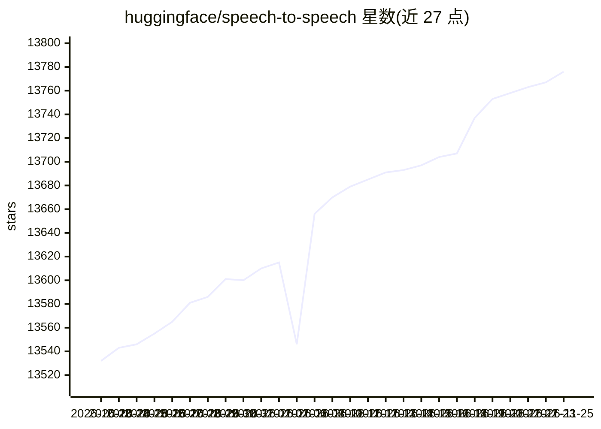

# huggingface/speech-to-speech

⭐ 13,776 · Python · Apache-2.0 · 推送 2026-11-23 · [GitHub](https://github.com/huggingface/speech-to-speech) · 组织维护

**本地运行的低延迟开源语音对话 agent，一条命令即用**

以 Silero VAD → Parakeet TDT → Qwen3.5-4B → Qwen3-TTS 四级流水线构建语音助手，完全在本机运行，无需 API key 与云服务；每级提供多个可替换后端并通过 CLI 选择。服务器实现 OpenAI Realtime 协议（WebSocket/WebRTC），面向 OpenAI Realtime API 的客户端可直接指向本地。默认安装面向 Apple Silicon 与 NVIDIA GPU/CPU 平台，可选组件经 pip extras 安装，MeloTTS 等实现已弃用并移入 archive/。

## 筛选速览

| 维度 | 判定 | 备注 |
|---|---|---|
| AI 角色 | `ai-native` | 本体是模型或模型工具 |
| 许可风险 | `permissive` | Apache-2.0 |
| 部署形态 | `self-host` | docker 或自建部署 |
| 模型依赖 | — | README 未给出锁定关系 |
| 硬件要求 | `cpu-ok` | |
| 安装摩擦 | `low` | 无编译、无系统依赖或容器化 |
| 成熟度 | — | 结构信号不足 |

## 动量与使用信号

- 维护:`active` — 距上次 push 1.4 天,年发版 5,65 位贡献者
- 涨星:近 1 天 **+12**(自 20261016 起算)
- 安装:pypi 包 `speech-to-speech` 月下载 2,270
- 平台:WINDOWS / MACOS / LINUX · 协议:OPENAI-API

## 能力要点

- 四级流水线各阶段后端可互换，CLI 参数选择
- 服务器兼容 OpenAI Realtime 协议，已对接 OpenAI Agents SDK 与 LiveKit Agents
- 首次下载模型后可完全离线运行
- 支持可选音素（viseme）输出与说话人分离

## 适用场景

- 在本机与语音助手实时对话
- 为 Reachy Mini 等机器人提供对话后端
- 把现有 OpenAI Realtime 客户端切换到自托管服务器
- 为虚拟形象/机器人客户端生成口型时间序列

## 场景标签

`语音 Agent` `AI 助手` · 领域:对话与助手

## 证据(README 行号)

> L11: A low-latency voice agent built from open models that **runs entirely on your computer**. One command starts a conv
> L13: The default pipeline is **Silero VAD → Parakeet TDT → Qwen3.5-4B → Qwen3-TTS**, and every stage is swappable. The s
> L92: - any client using the core OpenAI Realtime events; the OpenAI Agents SDK is tested over both transports (see Realt

## 星数曲线

2026-10-23 13,532 → 2026-11-25 13,776（+244）

---
*卡片 v1 · prompt 1.4 · 生成 2026-11-24 · 置信度 high · 依据 README sha `d655a800eb8d` · [字段定义](../../DATASET.md)*
