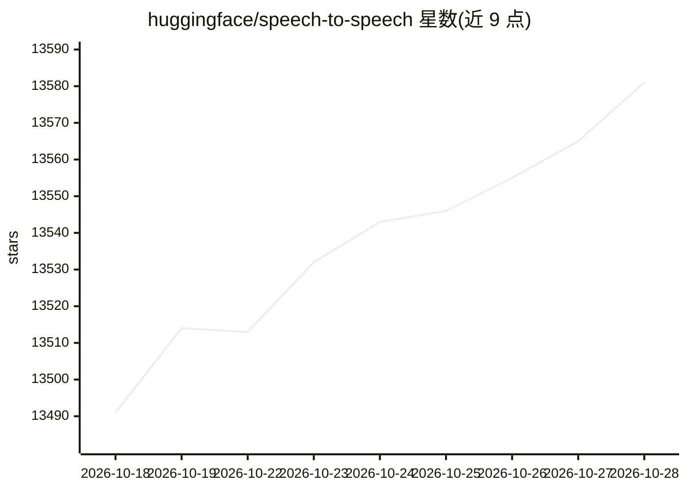

# huggingface/speech-to-speech

⭐ 13,581 · Python · Apache-2.0 · 推送 2026-10-26 · [GitHub](https://github.com/huggingface/speech-to-speech) · 组织维护

**全本地开源语音 agent 服务：一条命令起对话，免 API key**

Hugging Face 维护的低延迟语音 agent 服务：默认流水线为 Silero VAD → Parakeet TDT → Qwen3.5-4B → Qwen3-TTS，各阶段后端均可通过 CLI 替换，含大量 STT/LLM/TTS 备选。模型全部本地运行，首次运行后可离线工作；服务器通过 WebSocket/WebRTC 说 OpenAI Realtime 协议，使为 OpenAI Realtime API 构建的应用可指向自托管机器。该流水线已在数千台 Reachy Mini 机器人上作为对话后端运行。限制：Linux 默认 Qwen3-TTS wheel 面向 CUDA 12.8 与 Ubuntu 24.04；Windows 不在兼容矩阵内；Python 需 3.11–3.14。

## 筛选速览

| 维度 | 判定 | 备注 |
|---|---|---|
| AI 角色 | `ai-native` | 本体是模型或模型工具 |
| 许可风险 | `permissive` | Apache-2.0 |
| 部署形态 | `self-host` | docker 或自建部署 |
| 模型依赖 | local-ok | 支持本地模型 |
| 硬件要求 | — | 无带数字的原话,不猜 |
| 安装摩擦 | `low` | 无编译、无系统依赖或容器化 |
| 成熟度 | — | 结构信号不足 |

## 动量与使用信号

- 维护:`active` — 距上次 push 1.4 天,年发版 5,65 位贡献者
- 涨星:近 1 天 **+12**(自 20261016 起算)
- 安装:pypi 包 `speech-to-speech` 月下载 2,270
- 平台:WINDOWS / MACOS / LINUX · 协议:OPENAI-API

## 能力要点

- 默认四段流水线（VAD/STT/LLM/TTS）各阶段后端可互换
- 全本地运行，无 API key、无云服务，首次运行后离线可用
- 服务器说 OpenAI Realtime 协议（WebSocket/WebRTC），兼容 OpenAI Realtime 客户端与 LiveKit Agents
- 支持 YAML 配置 API、语音到音素（viseme）提取、说话人分离、本地工具调用

## 适用场景

- 在本机一条命令启动可对话的语音助手，不依赖云服务
- 把为 OpenAI Realtime API 构建的应用/设备端点切到自托管服务器
- 为机器人或 avatar 客户端提供带口型时序的实时语音对话后端

## 场景标签

`语音 Agent` · 领域:对话与助手

## 证据(README 行号)

> L11: A low-latency voice agent built from open models that **runs entirely on your computer**. One command starts a conv
> L13: The default pipeline is **Silero VAD → Parakeet TDT → Qwen3.5-4B → Qwen3-TTS**, and every stage is swappable. The s
> L92: 3. **Language Model (LLM)**: generates the response, streaming text and tool calls.

## 星数曲线

2026-10-18 13,491 → 2026-10-28 13,581（+90）

---
*卡片 v1 · prompt 1.4 · 生成 2026-10-20 · 置信度 mid · 依据 README sha `9a68c6bbbeb7` · [字段定义](../../DATASET.md)*
