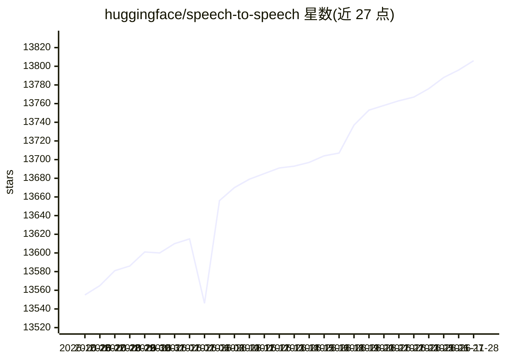

# huggingface/speech-to-speech

⭐ 13,806 · Python · Apache-2.0 · 推送 2026-11-27 · [GitHub](https://github.com/huggingface/speech-to-speech) · 组织维护

**开源模型搭建的本地低延迟语音对话 agent 流水线**

由开源模型组成的低延迟语音 agent 流水线，本机运行、无需 API key 与云服务。默认四级级联：Silero VAD → Parakeet TDT → Qwen3.5-4B → Qwen3-TTS，每级均有多个可通过 CLI 标志替换的后端（STT/TTS/LLM 共 20+ 个实现）。服务器实现 OpenAI Realtime 协议（WebSocket/WebRTC），供 OpenAI Realtime 客户端、LiveKit Agents、Open WebUI 等接入。pip 安装后一条命令开始对话，首次运行下载模型后可完全离线；按平台自动选择模型加载方式（Apple Silicon 走 MLX，NVIDIA 走 CUDA）。

## 筛选速览

| 维度 | 判定 | 备注 |
|---|---|---|
| AI 角色 | `ai-ecosystem` | LLM/agent 周边工具 |
| 许可风险 | `permissive` | Apache-2.0 |
| 部署形态 | `self-host` | docker 或自建部署 |
| 模型依赖 | local-ok | 支持本地模型 |
| 硬件要求 | — | 无带数字的原话,不猜 |
| 安装摩擦 | `low` | 无编译、无系统依赖或容器化 |
| 成熟度 | — | 结构信号不足 |

## 动量与使用信号

- 维护:`active` — 距上次 push 1.4 天,年发版 5,65 位贡献者
- 涨星:近 1 天 **+12**(自 20261016 起算)
- 安装:pypi 包 `speech-to-speech` 月下载 2,270
- 平台:WINDOWS / MACOS / LINUX · 协议:OPENAI-API

## 能力要点

- Silero VAD/Parakeet/Qwen3.5-4B/Qwen3-TTS 默认流水线，每级可换后端
- 服务器实现 OpenAI Realtime 协议（WebSocket/WebRTC），兼容 OpenAI Realtime 客户端
- 支持 LiveKit Agents、Open WebUI、浏览器 demo 等多种接入方式
- 首次运行后完全离线工作，可选 viseme 提取与说话人分离

## 适用场景

- 在本机搭建可语音对话的 assistant，无需云服务
- 把为 OpenAI Realtime API 开发的客户端切换到自托管服务器
- 为机器人（如 Reachy Mini）提供对话后端
- 按场景替换 STT/TTS/LLM 后端做语音流水线实验

## 场景标签

`语音 Agent` · 领域:对话与助手

## 证据(README 行号)

> L11: A low-latency voice agent built from open models that **runs entirely on your computer**. One command starts a conv
> L13: The default pipeline is **Silero VAD → Parakeet TDT → Qwen3.5-4B → Qwen3-TTS**, and every stage is swappable. The s
> L93: - any client using the core OpenAI Realtime events; the OpenAI Agents SDK is tested over both transports (see Realt

## 星数曲线

2026-10-26 13,555 → 2026-11-28 13,806（+251）

---
*卡片 v1 · prompt 1.4 · 生成 2026-11-28 · 置信度 mid · 依据 README sha `f761b7a9bf19` · [字段定义](../../DATASET.md)*
