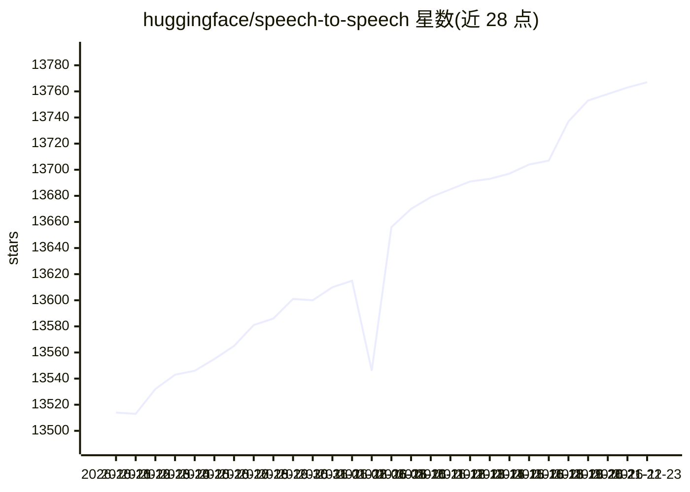

# huggingface/speech-to-speech

⭐ 13,767 · Python · Apache-2.0 · 推送 2026-11-19 · [GitHub](https://github.com/huggingface/speech-to-speech) · 组织维护

**本地全开源模型搭建低延迟语音对话 agent 的运行时**

以 Python 包形式提供的语音 agent 框架：默认流水线为 Silero VAD → Parakeet TDT → Qwen3.5-4B → Qwen3-TTS，四个阶段各自线程化、经队列相连，且每一级均可通过 CLI 旗标替换后端。服务器以 WebSocket/WebRTC 讲 OpenAI Realtime 协议，面向 OpenAI Realtime API 编写的客户端可指向本机自托管实例，无需 API key 与云服务；也支持 LiveKit Agents 与 OpenAI Agents SDK 接入。默认安装覆盖 macOS/Linux，Windows 未列入兼容矩阵；Linux 的默认 TTS wheel 依赖 CUDA 12.8 与 Ubuntu 24.04。

## 筛选速览

| 维度 | 判定 | 备注 |
|---|---|---|
| AI 角色 | `ai-ecosystem` | LLM/agent 周边工具 |
| 许可风险 | `permissive` | Apache-2.0 |
| 部署形态 | `self-host` | docker 或自建部署 |
| 模型依赖 | local-ok | 支持本地模型 |
| 硬件要求 | `cpu-ok` | |
| 安装摩擦 | `low` | 无编译、无系统依赖或容器化 |
| 成熟度 | — | 结构信号不足 |

## 动量与使用信号

- 维护:`active` — 距上次 push 1.4 天,年发版 5,65 位贡献者
- 涨星:近 1 天 **+12**(自 20261016 起算)
- 安装:pypi 包 `speech-to-speech` 月下载 2,270
- 平台:WINDOWS / MACOS / LINUX · 协议:OPENAI-API

## 能力要点

- 一条命令启动本地语音对话，无需 API key 与云服务，首跑后可离线运行
- VAD/STT/LLM/TTS 四级流水线，每级提供多个可互换后端（表格列出 30+ 组合）
- 服务器实现 OpenAI Realtime 协议，兼容 OpenAI Agents SDK 与 LiveKit Agents
- 按平台自动选模型：Apple Silicon 走 MLX，NVIDIA GPU 走 Transformers，其余走 CPU

## 适用场景

- 在自己电脑上跑一套完全本地的语音助手对话
- 把现有 OpenAI Realtime 客户端切换到自托管服务器
- 为机器人或头像应用提供语音对话后端（README 提及用于 Reachy Mini）
- 按需替换 STT/LLM/TTS 各级模型做语音 agent 实验

## 场景标签

`语音 Agent` `Agent 框架` · 领域:Agent 开发

## 证据(README 行号)

> L11: A low-latency voice agent built from open models that **runs entirely on your computer**. One command starts a conv
> L13: The default pipeline is **Silero VAD → Parakeet TDT → Qwen3.5-4B → Qwen3-TTS**, and every stage is swappable. The s
> L92: - any client using the core OpenAI Realtime events; the OpenAI Agents SDK is tested over both transports (see Realt

## 星数曲线

2026-10-21 13,514 → 2026-11-23 13,767（+253）

---
*卡片 v1 · prompt 1.4 · 生成 2026-11-22 · 置信度 mid · 依据 README sha `8de2126be6c5` · [字段定义](../../DATASET.md)*
