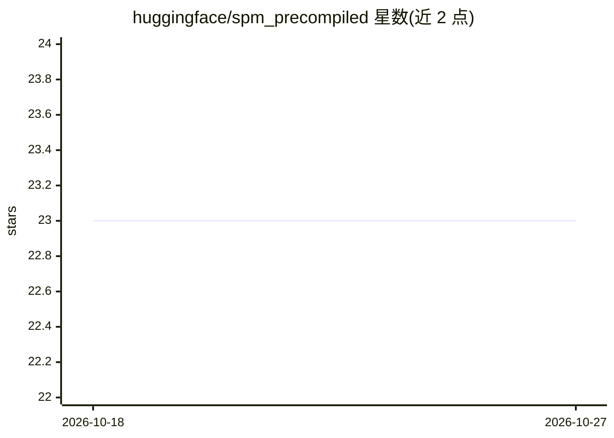

# huggingface/spm_precompiled

⭐ 23 · Rust · Apache-2.0 · 推送 2026-09-23 · [GitHub](https://github.com/huggingface/spm_precompiled) · 组织维护

**解析 sentencepiece precompiled_charsmap 的 Rust crate，供 tokenizers 使用**

高度专用化的 Rust crate，模仿 google/sentencepiece 的 Dart::DoubleArray 结构与 Normalizer，读取 sentencepiece 的二进制 precompiled_charsmap 并复现其规范化逻辑。主要用途是作为 tokenizers 库的组件，tokenizers 是为 HuggingFace transformers 库提供字符串分词设施的 Rust 库。README 明确声明该 crate 不面向通用用途。

## 筛选速览

| 维度 | 判定 | 备注 |
|---|---|---|
| AI 角色 | `ai-ecosystem` | LLM/agent 周边工具 |
| 许可风险 | `permissive` | Apache-2.0 |
| 部署形态 | `None` |  |
| 模型依赖 | — | README 未给出锁定关系 |
| 硬件要求 | — | 无带数字的原话,不猜 |
| 安装摩擦 | `low` | 无编译、无系统依赖或容器化 |
| 成熟度 | — | 结构信号不足 |

## 能力要点

- 读取并解析 sentencepiece 二进制 precompiled_charsmap
- 复现 Dart::DoubleArray 结构与 Normalizer 行为
- 面向 tokenizers（HuggingFace transformers 的分词库）

## 适用场景

- 在 Rust tokenizers 中加载 sentencepiece 预编译字符映射
- 复现 sentencepiece 的规范化行为

## 场景标签

 · 领域:NLP/分词基础设施

## 证据(README 行号)

> L7: struct and it's Normalizer. It's main intent is to be used with tokenizers
> L8: that is a Rust library that aims to provide facilities to tokenize string

## 星数曲线

2026-10-18 23 → 2026-10-27 23（+0）

---
*卡片 v1 · prompt 1.4 · 生成 2026-10-27 · 置信度 high · 依据 README sha `b47c1c65b481` · [字段定义](../../DATASET.md)*
