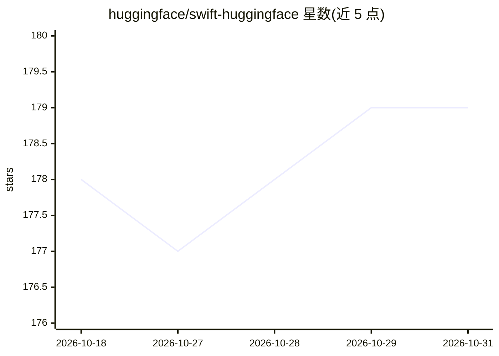

# huggingface/swift-huggingface

⭐ 179 · Swift · Apache-2.0 · 推送 2026-10-29 · [GitHub](https://github.com/huggingface/swift-huggingface) · [官网](https://huggingface.co/docs/hub/index) · 组织维护

**Hugging Face Hub 与 Inference Providers 的 Swift 客户端库**

面向 Swift 开发者的 Hugging Face 官方客户端库，覆盖两套 API：Hub API 用于管理模型、数据集、Spaces、仓库、集合、论文、组织、讨论等资源，含文件下载缓存、快照下载、分页遍历与错误处理；Inference Providers API 用于运行聊天补全、文生图等 AI 任务。支持环境变量/文件自动检测 token 与 OAuth 认证（单独的 HuggingFaceOAuth 产品），可选 Xet trait。要求 Swift 6.0+，支持 macOS/iOS/watchOS/tvOS/visionOS/Linux。

## 筛选速览

| 维度 | 判定 | 备注 |
|---|---|---|
| AI 角色 | `ai-ecosystem` | LLM/agent 周边工具 |
| 许可风险 | `permissive` | Apache-2.0 |
| 部署形态 | `None` |  |
| 模型依赖 | — | README 未给出锁定关系 |
| 硬件要求 | — | 无带数字的原话,不猜 |
| 安装摩擦 | `low` | 无编译、无系统依赖或容器化 |
| 成熟度 | — | 结构信号不足 |

## 能力要点

- Hub API 覆盖模型/数据集/Spaces/仓库/集合/论文/组织等资源管理与文件操作
- 通过 Inference Providers API 运行聊天补全、文生图等 AI 任务
- token 环境自动检测与 OAuth 认证（HuggingFaceOAuth 独立产品）
- 与 Python 兼容的下载缓存目录与 Link 头分页遍历

## 适用场景

- 在 iOS/macOS 应用中接入 Hugging Face Hub 管理模型与数据集
- Swift 项目中调用 Inference Providers 运行聊天补全、文生图等任务
- 构建需要 HF 用户登录（OAuth）的 Swift 应用

## 场景标签

 · 领域:AI 基础设施/客户端库

## 证据(README 行号)

> L3: A Swift client for Hugging Face, providing access to both
> L6: the Inference Providers API
> L7: for running AI tasks like chat completion, text-to-image generation, and more.

## 星数曲线

2026-10-18 178 → 2026-10-31 179（+1）

---
*卡片 v1 · prompt 1.4 · 生成 2026-10-22 · 置信度 high · 依据 README sha `8c26d7b2badf` · [字段定义](../../DATASET.md)*
