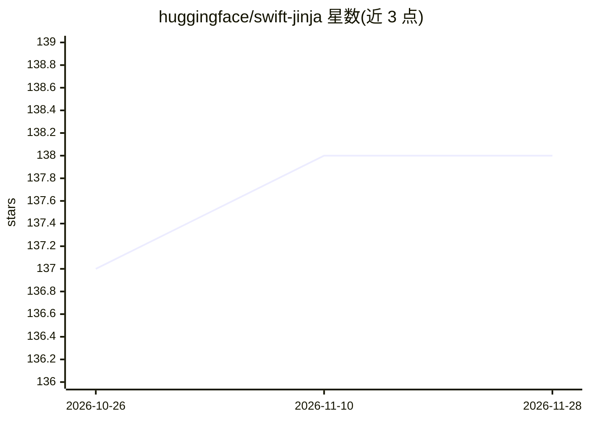

# huggingface/swift-jinja

⭐ 138 · Swift · Apache-2.0 · 推送 2026-11-25 · [GitHub](https://github.com/huggingface/swift-jinja) · 组织维护

**Swift 版 Jinja 模板引擎库：解析渲染 LLM 聊天模板**

Hugging Face 维护的 Swift 实现，实现 Jinja2 模板引擎的一个子集，重点覆盖生成 LLM 聊天模板所需的功能：变量、条件、循环、宏、过滤器、tests、异常处理，以及标记助手生成内容的  扩展。tojson 过滤器输出与 transformers 的 json.dumps 一致，保证聊天模板跨实现渲染结果相同。通过 Swift Package Manager 集成，要求 Swift 6.0+/Xcode 16+；不支持模板继承、include、import、autoescape 等 Python 版特性。

## 筛选速览

| 维度 | 判定 | 备注 |
|---|---|---|
| AI 角色 | `ai-ecosystem` | LLM/agent 周边工具 |
| 许可风险 | `permissive` | Apache-2.0 |
| 部署形态 | `None` |  |
| 模型依赖 | — | README 未给出锁定关系 |
| 硬件要求 | — | 无带数字的原话,不猜 |
| 安装摩擦 | `low` | 无编译、无系统依赖或容器化 |
| 成熟度 | — | 结构信号不足 |

## 能力要点

- 实现 Jinja2 子集，聚焦 LLM 聊天模板渲染
- tojson 输出与 transformers json.dumps 对齐（默认 .transformers 预设，可切换 .jinja2）
- 支持宏、过滤器（52 个）、tests（29 个）与  HF 扩展
- 通过 Swift Package Manager 提供包依赖

## 适用场景

- Swift 应用中渲染模型对话的聊天模板
- 本地推理场景下与 transformers 保持一致的模板输出
- 生成 HTML、配置文件等一般模板用途

## 场景标签

 · 领域:LLM 基础设施/推理工具链

## 证据(README 行号)

> L7: This implementation is focused primarily on the features needed to generate LLM chat templates.
> L267: so a chat template renders the same text here as it does in

## 星数曲线

2026-10-26 137 → 2026-11-28 138（+1）

---
*卡片 v1 · prompt 1.4 · 生成 2026-11-27 · 置信度 high · 依据 README sha `22f41b67e16b` · [字段定义](../../DATASET.md)*
