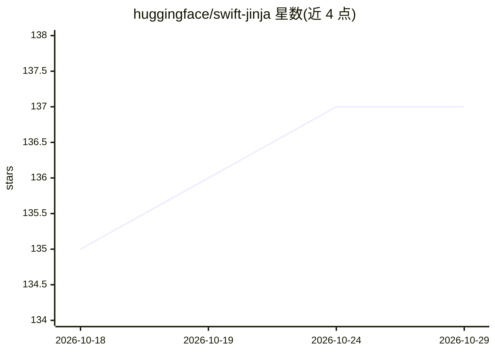

# huggingface/swift-jinja

⭐ 137 · Swift · Apache-2.0 · 推送 2026-10-27 · [GitHub](https://github.com/huggingface/swift-jinja) · 组织维护

**Swift 实现的 Jinja 模板引擎，用于渲染 LLM 聊天模板**

Hugging Face 维护的 Jinja2 模板引擎 Swift 实现，聚焦生成 LLM 聊天模板所需功能：支持变量、条件、循环、宏、过滤器、测试等子集，另含  扩展块标记助手生成内容；tojson 过滤器行为与 Python json.dumps 及 transformers 一致（默认 .transformers 预设）。不支持模板继承、include、import、自定义扩展等特性。面向在 Swift/App 生态中渲染聊天模板的开发者，经 Swift Package Manager 集成，需 Swift 6.0+/Xcode 16+。

## 筛选速览

| 维度 | 判定 | 备注 |
|---|---|---|
| AI 角色 | `ai-ecosystem` | LLM/agent 周边工具 |
| 许可风险 | `permissive` | Apache-2.0 |
| 部署形态 | `None` |  |
| 模型依赖 | — | README 未给出锁定关系 |
| 硬件要求 | — | 无带数字的原话,不猜 |
| 安装摩擦 | `low` | 无编译、无系统依赖或容器化 |
| 成熟度 | — | 结构信号不足 |

## 能力要点

- 覆盖 Jinja 子集：变量/条件/循环/宏/50+过滤器/30+测试
-  扩展块标记助手生成内容
- tojson 与 transformers 的 json.dumps 输出一致，提供 .transformers/.jinja2 预设
- v2.0 将上下文类型从 [String: Any] 改为 [String: Value]

## 适用场景

- 在 Swift 应用中按 Hugging Face 聊天模板格式化消息
- 生成 HTML、配置文件等文本输出
- 替代 Python Jinja2 做确定性文本模板渲染

## 场景标签

 · 领域:LLM 基础设施/模板渲染

## 证据(README 行号)

> L7: This implementation is focused primarily on the features needed to generate LLM chat templates.
> L407: // Format chat messages (useful for AI/LLM applications)

## 星数曲线

2026-10-18 135 → 2026-10-29 137（+2）

---
*卡片 v1 · prompt 1.4 · 生成 2026-10-22 · 置信度 high · 依据 README sha `1febbd283c7c` · [字段定义](../../DATASET.md)*
