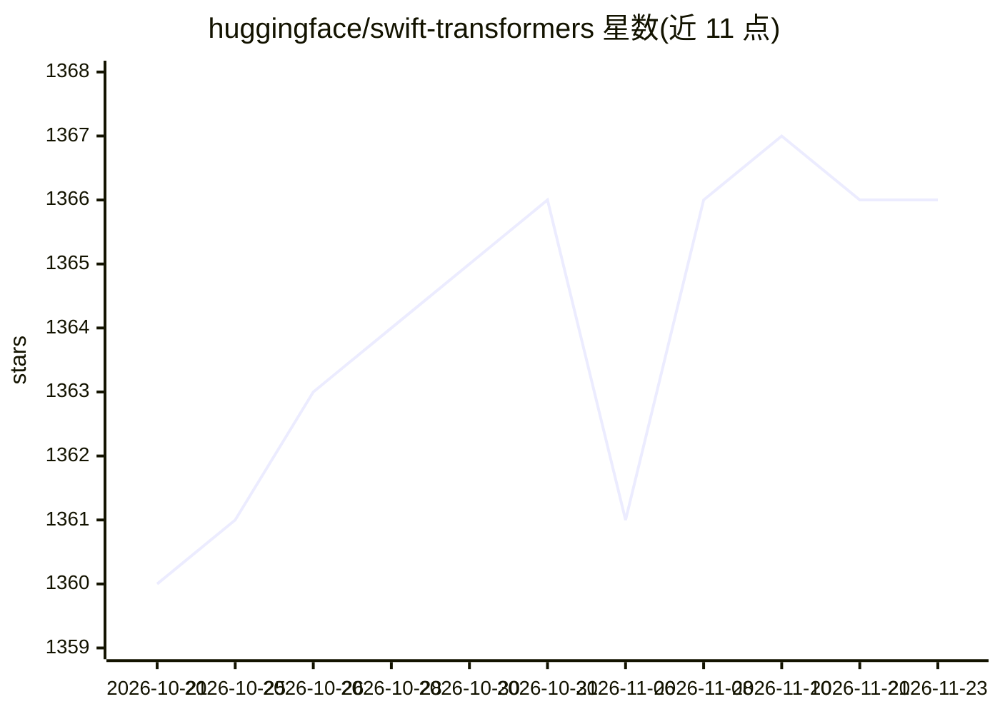

# huggingface/swift-transformers

⭐ 1,366 · Swift · Apache-2.0 · 推送 2026-11-06 · [GitHub](https://github.com/huggingface/swift-transformers) · 组织维护

**为 Swift 应用提供 transformers 风格 API 的库**

Hugging Face 维护的 Swift Package，包含三个可选模块：Tokenizers 加载 BPE/WordPiece/Unigram 分词器配置并用 swift-jinja 渲染含工具规范的聊天模板；Hub 模块下载模型与分词器资产，带缓存、进度回传与可选 Xet 传输；Models/Generation 提供 Core ML 模型加载与文本生成工具。API 面向熟悉 Python transformers 库的开发者，支持 macOS 13+/iOS 16+/Linux，Core ML 推理需 macOS 15+/iOS 18+，Linux 无 Core ML 推理。

## 筛选速览

| 维度 | 判定 | 备注 |
|---|---|---|
| AI 角色 | `ai-ecosystem` | LLM/agent 周边工具 |
| 许可风险 | `permissive` | Apache-2.0 |
| 部署形态 | `self-host` | docker 或自建部署 |
| 模型依赖 | — | README 未给出锁定关系 |
| 硬件要求 | — | 无带数字的原话,不猜 |
| 安装摩擦 | `low` | 无编译、无系统依赖或容器化 |
| 成熟度 | — | 结构信号不足 |

## 能力要点

- 支持 BPE、WordPiece、Unigram 分词器及聊天模板渲染（含工具调用规范）
- Hub 模块支持缓存、进度回传、私有仓库 token 认证与可选 Xet 并行下载
- 支持本地/离线加载分词器文件，无需访问 Hub
- 提供 Core ML 模型加载与文本生成工具（附 Mistral 7B 示例）

## 适用场景

- 在 Swift/iOS 应用中加载 Hugging Face 分词器并做编解码
- 为本地或 Hub 上的模型资产实现下载与缓存
- 在 Core ML 中转换并运行语言模型（如 Mistral 7B）
- 为支持工具调用的模型格式化消息与工具规范

## 场景标签

`推理引擎` · 领域:训练与推理

## 证据(README 行号)

> L5: `swift-transformers` provides tokenizers, chat templates, Hub downloads, and Core ML utilities for language models i
> L13: - **Tokenizers** loads Hugging Face tokenizer configurations for BPE, WordPiece, and Unigram models, and renders ch
> L14: - **Hub** downloads model files and tokenizer assets, with caching, progress reporting, and optional Xet transport.

## 星数曲线

2026-10-21 1,360 → 2026-11-23 1,366（+6）

---
*卡片 v1 · prompt 1.4 · 生成 2026-11-23 · 置信度 mid · 依据 README sha `e8dc9b098dff` · [字段定义](../../DATASET.md)*
