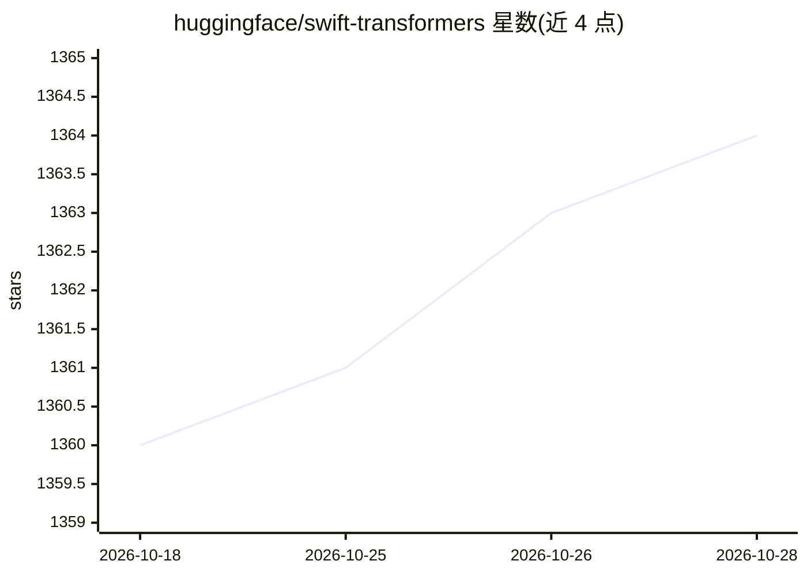

# huggingface/swift-transformers

⭐ 1,364 · Swift · Apache-2.0 · 推送 2026-10-28 · [GitHub](https://github.com/huggingface/swift-transformers) · 组织维护

**在 Swift 应用中接入语言模型的工具库**

Hugging Face 维护的 Swift Package，提供与 Python transformers 库风格相近的 Swift API，核心模块包括 Tokenizers（分词、聊天模板、工具调用格式化）、Hub（模型下载、进度报告、断连处理）、Models/Generation（CoreML 语言模型工具）。支持打包离线 CoreML 模型与分词器免网络运行，可选 Xet trait 加速下载（需 Swift 6.1+）。面向在 Apple 平台开发端侧 ML 应用的开发者，被 WhisperKit、MLX Swift Examples 等项目使用。

## 筛选速览

| 维度 | 判定 | 备注 |
|---|---|---|
| AI 角色 | `ai-ecosystem` | LLM/agent 周边工具 |
| 许可风险 | `permissive` | Apache-2.0 |
| 部署形态 | `None` |  |
| 模型依赖 | — | README 未给出锁定关系 |
| 硬件要求 | — | 无带数字的原话,不猜 |
| 安装摩擦 | `low` | 无编译、无系统依赖或容器化 |
| 成熟度 | — | 结构信号不足 |

## 能力要点

- AutoTokenizer 分词、聊天模板与 tool calling 输入格式化
- 从 Hugging Face Hub 下载模型，含进度报告与弱网处理
- CoreML 语言模型转换与运行工具及离线分词器注入
- 可选 Xet trait 并行加速 Hub 下载

## 适用场景

- 在 Swift/iOS 应用中加载和分词 Hugging Face 模型
- 构建端侧 CoreML 语言模型应用并离线运行
- 为 LLM 应用实现 tool calling 输入格式化

## 场景标签

`推理引擎` · 领域:训练与推理

## 证据(README 行号)

> L5: `swift-transformers` is a collection of utilities to help adopt language models in Swift apps.
> L15: The most commonly used modules from `swift-transformers` are `Tokenizers` and `Hub`, which allow fast tokenization 

## 星数曲线

2026-10-18 1,360 → 2026-10-28 1,364（+4）

---
*卡片 v1 · prompt 1.4 · 生成 2026-10-21 · 置信度 high · 依据 README sha `9117e5c06fbb` · [字段定义](../../DATASET.md)*
