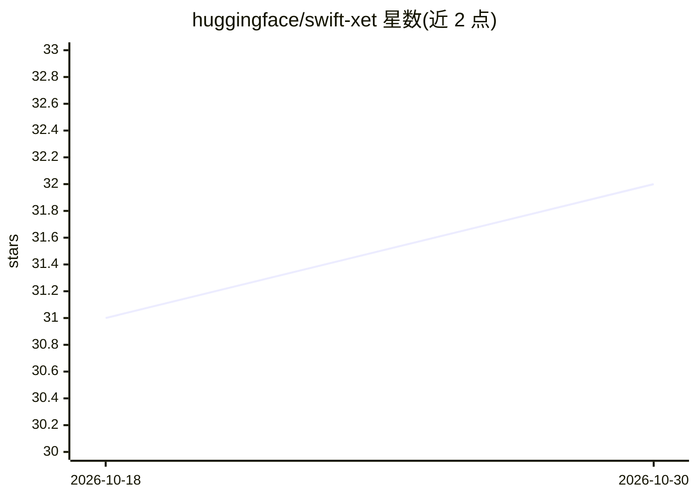

# huggingface/swift-xet

⭐ 32 · Swift · Apache-2.0 · 推送 2026-10-12 · [GitHub](https://github.com/huggingface/swift-xet) · 组织维护

**Swift 版 Xet 协议库：从 Hugging Face 内容寻址存储下载文件**

Hugging Face 官方维护的 Swift 库，实现 Xet 协议的下载路径，供 Swift 应用从 Hugging Face Hub 仓库获取使用 Xet 存储的文件（含 models/datasets/spaces）。Xet 通过内容定义分块、去重与压缩提供高效传输；库实现 token 刷新、重建元数据查询、分块下载、LZ4/BG4+LZ4 解压与重组。支持字节区间部分下载、进度回调（100ms 节流、计数不回退）、基于 AsyncHTTPClient 的连接池调优，以及带指数退避的网络重试（408/429/5xx，最多 5 次，失败的分块下载续传）。仅覆盖下载路径，不含上传。要求 Swift 6.0+/Xcode 16+，支持 macOS/iOS/tvOS/watchOS/visionOS/Linux。

## 筛选速览

| 维度 | 判定 | 备注 |
|---|---|---|
| AI 角色 | `ai-ecosystem` | LLM/agent 周边工具 |
| 许可风险 | `permissive` | Apache-2.0 |
| 部署形态 | `None` |  |
| 模型依赖 | — | README 未给出锁定关系 |
| 硬件要求 | — | 无带数字的原话,不猜 |
| 安装摩擦 | `low` | 无编译、无系统依赖或容器化 |
| 成熟度 | — | 结构信号不足 |

## 能力要点

- 内容定义分块、去重与压缩的 Xet 存储下载路径
- byteRange 部分下载与确定性进度回调语义
- AsyncHTTPClient 连接池与超时可配置
- 指数退避重试且跳过已接收分块

## 适用场景

- 在 iOS/macOS 应用中下载 Hugging Face 仓库中 Xet 存储的模型或数据文件
- 按字节区间获取大文件片段，节省带宽与内存
- 磁盘下载时内存占用受网络缓冲而非文件大小限制，适合大文件场景

## 场景标签

 · 领域:开发库/文件传输基础设施

## 证据(README 行号)

> L3: A Swift implementation of the
> L10: enabling Swift applications to fetch files from Hugging Face Hub repositories

## 星数曲线

2026-10-18 31 → 2026-10-30 32（+1）

---
*卡片 v1 · prompt 1.4 · 生成 2026-10-26 · 置信度 high · 依据 README sha `5f89ea1dde24` · [字段定义](../../DATASET.md)*
