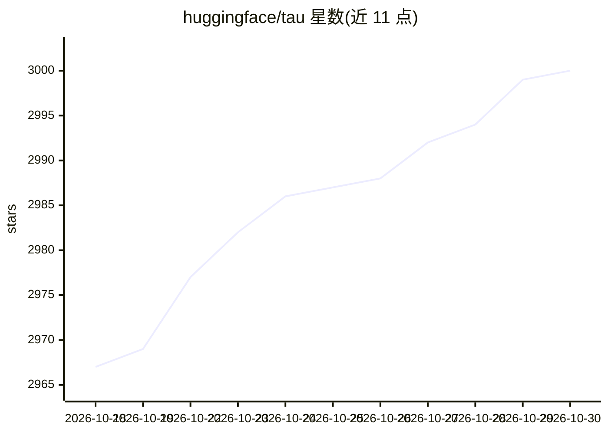

# huggingface/tau

⭐ 3,000 · Python · MIT · 推送 2026-10-27 · [GitHub](https://github.com/huggingface/tau) · [官网](http://twotimespi.dev/) · 组织维护

**终端里的 Python 编码 agent：读代码、改文件、跑命令**

Tau 是运行于终端的编码 agent，以自然语言请求驱动：可读取文件、编辑代码、执行 bash 命令，并以 JSONL 追加式会话保存历史、支持恢复与分支。架构分三层：tau_ai 将各模型提供方转为中立事件流，tau_agent 提供可复用的 harness（消息/工具/循环原语），tau_coding 包装为带 CLI/TUI 的编码应用。内置 OpenAI、Anthropic、OpenRouter、Hugging Face 及 OpenAI 兼容端点支持，也可作为 Python 库嵌入自建前端。需 Python 3.12+，项目自述处于积极开发中。既是终端工具，也是编码 agent 构建方式的教学示例。

## 筛选速览

| 维度 | 判定 | 备注 |
|---|---|---|
| AI 角色 | `ai-native` | 本体是模型或模型工具 |
| 许可风险 | `permissive` | MIT |
| 部署形态 | `library` | 以包/库形式分发 |
| 模型依赖 | locked-api |  |
| 硬件要求 | — | 无带数字的原话,不猜 |
| 安装摩擦 | `low` | 无编译、无系统依赖或容器化 |
| 成熟度 | `idea` | |

## 能力要点

- 内置 read/write/edit/bash 编码工具与 Textual TUI / 非交互 print 模式
- JSONL 持久会话，支持恢复、分支与上下文压缩
- 支持 OpenAI、Anthropic、OpenRouter、Hugging Face 与自定义 OpenAI 兼容端点
- AgentHarness 可作为库复用，事件流驱动自定义前端

## 适用场景

- 在终端里让 agent 解释仓库、补测试、修报错
- 以库形式复用 harness 搭建自己的 agent 前端
- 阅读源码学习编码 agent 的分层结构

## 场景标签

`编码 Agent` `教程课程` · 领域:编码与开发

## 证据(README 行号)

> L19: **Tau is a coding agent that lives in your terminal.** You type requests like
> L35: - `tau_coding` wraps the brain as a real coding app: CLI, TUI, file/shell tools,
> L156: Tau ships with support for OpenAI, Anthropic, OpenAI Codex subscription auth,

## 星数曲线

2026-10-18 2,967 → 2026-10-30 3,000（+33）

---
*卡片 v1 · prompt 1.4 · 生成 2026-10-20 · 置信度 high · 依据 README sha `1e886b4270fd` · [字段定义](../../DATASET.md)*
