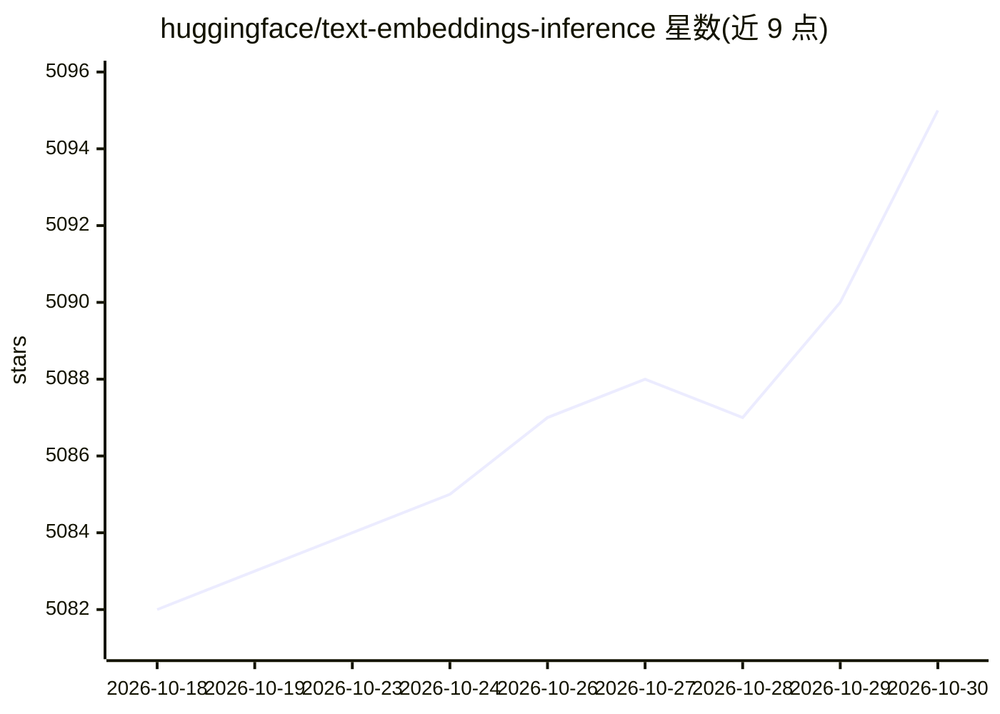

# huggingface/text-embeddings-inference

⭐ 5,095 · Rust · Apache-2.0 · 推送 2026-10-13 · [GitHub](https://github.com/huggingface/text-embeddings-inference) · [官网](https://huggingface.co/docs/text-embeddings-inference/quick_tour) · 组织维护

**文本嵌入模型的高性能推理服务，提供嵌入/重排/分类 API**

Hugging Face 维护的文本嵌入推理服务：以 Docker 镜像或本地二进制运行 text-embeddings-router，加载 BERT/XLM-RoBERTa/Mistral/GTE/Qwen2/Qwen3/Gemma3/ModernBERT 等模型，通过 HTTP REST（含 Swagger 文档）或 gRPC 提供 /embed、/rerank、/predict、/embed_sparse（SPLADE 稀疏嵌入）端点；支持私有/门控模型（HF_TOKEN）、离线部署与 OpenTelemetry 分布式追踪。面向需要自托管嵌入服务的开发者与团队。Docker 镜像覆盖 CPU 到 Blackwell GPU 多种后端，Apple Silicon 提供 Homebrew 预编译包；CUDA 计算能力低于 7.5 的 GPU 不受支持。

## 筛选速览

| 维度 | 判定 | 备注 |
|---|---|---|
| AI 角色 | `ai-ecosystem` | LLM/agent 周边工具 |
| 许可风险 | `permissive` | Apache-2.0 |
| 部署形态 | `self-host` | docker 或自建部署 |
| 模型依赖 | — | README 未给出锁定关系 |
| 硬件要求 | `cpu-ok` | |
| 安装摩擦 | `low` | 无编译、无系统依赖或容器化 |
| 成熟度 | `idea` | |

## 能力要点

- HTTP/gRPC 双 API，提供 embed/rerank/predict/embed_sparse 端点
- 覆盖 CPU、Apple Silicon Metal、CUDA（Turing 至 Blackwell）多后端 Docker 镜像
- 支持序列分类与重排（cross-encoder）模型及 SPLADE 稀疏池化
- 支持 HF_TOKEN 私有模型、离线部署与 OpenTelemetry 追踪

## 适用场景

- 自托管文本嵌入服务，为 RAG 检索流水线生成向量
- 部署重排模型提升检索结果排序质量
- 在生产环境用 gRPC 高性能调用嵌入与分类端点

## 场景标签

`推理引擎` · 领域:训练与推理

## 证据(README 行号)

> L74: docker run --gpus all -p 8080:80 -v $volume:/data --pull always ghcr.io/huggingface/text-embeddings-inference:cuda-
> L234: `text-embeddings-inference` offers a gRPC API as an alternative to the default HTTP API for high performance
> L23: Text Embeddings Inference currently supports Nomic, BERT, CamemBERT, XLM-RoBERTa models with absolute positions, Ji

## 星数曲线

2026-10-18 5,082 → 2026-10-30 5,095（+13）

---
*卡片 v1 · prompt 1.4 · 生成 2026-10-20 · 置信度 high · 依据 README sha `4e0bbd7241a3` · [字段定义](../../DATASET.md)*
