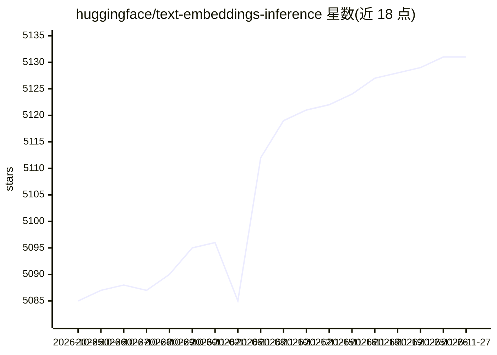

# huggingface/text-embeddings-inference

⭐ 5,131 · Rust · Apache-2.0 · 推送 2026-11-25 · [GitHub](https://github.com/huggingface/text-embeddings-inference) · [官网](https://huggingface.co/docs/text-embeddings-inference/quick_tour) · 组织维护

**文本嵌入与重排序模型的服务化推理服务器**

面向文本嵌入模型的推理服务：加载 Hugging Face Hub 上的 BERT、XLM-RoBERTa、Qwen3、JinaBERT、Alibaba GTE 等架构的嵌入模型，以及序列分类与重排序（cross-encoder）模型，通过 HTTP REST（/embed、/rerank、/predict）或 gRPC 端点提供嵌入、稀疏嵌入（SPLADE pooling）与相似度打分输出。以 Docker 镜像按 GPU 架构分发，也提供 Homebrew 预编译二进制（Apple Silicon，Metal 加速）与源码编译路径；内置 OpenTelemetry 分布式追踪与 Prometheus 指标，支持私有/gated 模型令牌配置与离线部署。

## 筛选速览

| 维度 | 判定 | 备注 |
|---|---|---|
| AI 角色 | `ai-ecosystem` | LLM/agent 周边工具 |
| 许可风险 | `permissive` | Apache-2.0 |
| 部署形态 | `self-host` | docker 或自建部署 |
| 模型依赖 | — | README 未给出锁定关系 |
| 硬件要求 | `cpu-ok` | |
| 安装摩擦 | `low` | 无编译、无系统依赖或容器化 |
| 成熟度 | — | 结构信号不足 |

## 能力要点

- 支持嵌入、重排序、序列分类三类模型，输出 /embed、/rerank、/predict 端点
- 提供 HTTP REST、gRPC 两套 API 与 OpenAPI/Swagger 文档
- 针对 Turing/Ampere/Ada/Hopper/Blackwell 等 GPU 架构分别提供 Docker 镜像，另有 CPU x86_64/aarch64 与 Apple Silicon Metal 版本
- 内置 OpenTelemetry 追踪与 Prometheus /metrics 指标

## 适用场景

- 为 RAG 流水线部署嵌入与重排序服务
- 在私有化/离线环境中托管嵌入模型
- 对文本做情感等序列分类预测

## 场景标签

`推理引擎` · 领域:训练与推理

## 证据(README 行号)

> L10: A blazing fast inference solution for text embeddings models.
> L74: docker run --gpus all -p 8080:80 -v $volume:/data --pull always ghcr.io/huggingface/text-embeddings-inference:cuda-
> L122: You can consult the OpenAPI documentation of the `text-embeddings-inference` REST API using the `/docs` route.

## 星数曲线

2026-10-25 5,085 → 2026-11-27 5,131（+46）

---
*卡片 v1 · prompt 1.4 · 生成 2026-11-26 · 置信度 high · 依据 README sha `ae9eae6e6a78` · [字段定义](../../DATASET.md)*
