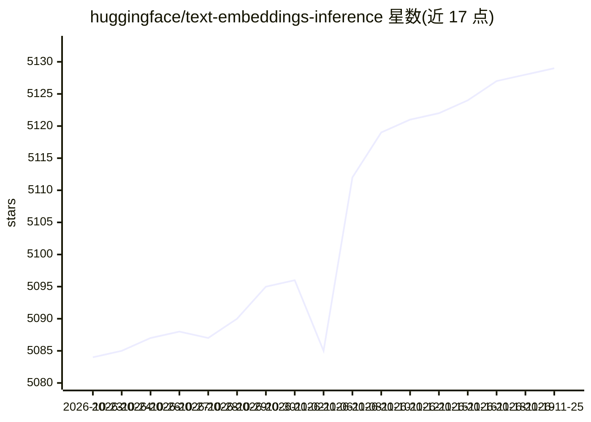

# huggingface/text-embeddings-inference

⭐ 5,129 · Rust · Apache-2.0 · 推送 2026-11-17 · [GitHub](https://github.com/huggingface/text-embeddings-inference) · [官网](https://huggingface.co/docs/text-embeddings-inference/quick_tour) · 组织维护

**文本嵌入模型推理服务：为开发者托管嵌入、重排与分类模型**

Hugging Face 出品的文本嵌入模型推理服务，以 HTTP/gRPC 服务器形式运行 BERT、Qwen3、Gemma3、JinaBERT 等架构的嵌入模型，另支持序列分类与重排序（cross-encoder）模型及 SPLADE 稀疏嵌入。通过 Docker 镜像按 CPU 与多种 NVIDIA GPU 架构分发，提供 /embed、/rerank、/predict 等端点、OpenAPI 文档、私有/gated 模型访问、离线部署、OpenTelemetry 追踪与 Prometheus 指标。Apple Silicon 提供 Homebrew 预编译二进制并支持 Metal 加速，CPU 场景需从源码用 Rust 编译。

## 筛选速览

| 维度 | 判定 | 备注 |
|---|---|---|
| AI 角色 | `ai-ecosystem` | LLM/agent 周边工具 |
| 许可风险 | `permissive` | Apache-2.0 |
| 部署形态 | `self-host` | docker 或自建部署 |
| 模型依赖 | — | README 未给出锁定关系 |
| 硬件要求 | — | 无带数字的原话,不猜 |
| 安装摩擦 | `low` | 无编译、无系统依赖或容器化 |
| 成熟度 | — | 结构信号不足 |

## 能力要点

- 支持嵌入、重排序、序列分类与 SPLADE 稀疏嵌入四类任务
- 按 GPU 架构提供多种 Docker 镜像，含 gRPC API 变体
- 内置 OpenTelemetry 分布式追踪与 Prometheus 指标导出
- 支持 HF_TOKEN 访问私有/gated 模型与离线挂载部署

## 适用场景

- 为 RAG 流水线部署嵌入与重排序模型服务
- 集中托管 embedding API 供多个应用调用
- 离线/内网环境中部署嵌入推理
- 监控生产环境的嵌入服务延迟与吞吐指标

## 场景标签

`推理引擎` `语义搜索` · 领域:知识与检索

## 证据(README 行号)

> L10: A blazing fast inference solution for text embeddings models.
> L74: docker run --gpus all -p 8080:80 -v $volume:/data --pull always ghcr.io/huggingface/text-embeddings-inference:cuda-
> L272: `text-embeddings-inference` offers a gRPC API as an alternative to the default HTTP API for high performance

## 星数曲线

2026-10-23 5,084 → 2026-11-25 5,129（+45）

---
*卡片 v1 · prompt 1.4 · 生成 2026-11-22 · 置信度 high · 依据 README sha `a6f334a86972` · [字段定义](../../DATASET.md)*
