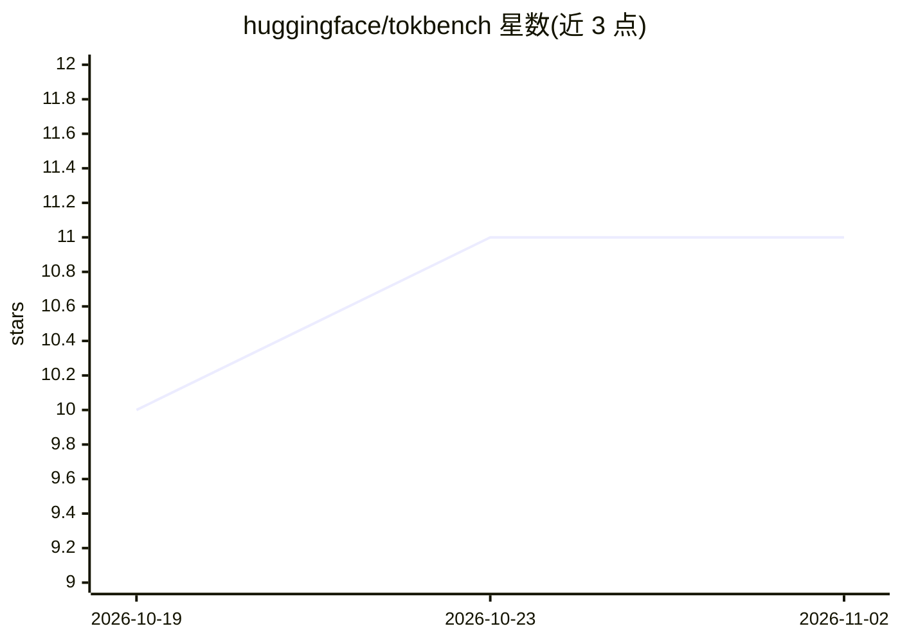

# huggingface/tokbench

⭐ 11 · Rust · Apache-2.0 · 推送 2026-10-27 · [GitHub](https://github.com/huggingface/tokbench) · 组织维护

**分词器实现的公平基准测试框架，含 id 校验门**

Hugging Face 维护的分词器（tokenizer）性能基准：一个引擎一个适配器，测量 encode/decode/延迟/线程扩展/内存/包体积等 6 类指标；通过 FNV-1a 哈希校验输出 ids 与参考引擎一致，不一致标记 differ 并排除排名；加载不计入编码计时，语料可控制 pretoken 重复率以区分缓存收益。覆盖 hf-tokenizers、pipeline、tiktoken、sentencepiece、llama.cpp 等约 13 个引擎，Rust 编写，支持 Hugging Face Jobs 云上可复现运行与单文件 dashboard，Apache-2.0 许可。

## 筛选速览

| 维度 | 判定 | 备注 |
|---|---|---|
| AI 角色 | `ai-ecosystem` | LLM/agent 周边工具 |
| 许可风险 | `permissive` | Apache-2.0 |
| 部署形态 | `None` |  |
| 模型依赖 | local-ok | 支持本地模型 |
| 硬件要求 | — | 无带数字的原话,不猜 |
| 安装摩擦 | `low` | 无编译、无系统依赖或容器化 |
| 成熟度 | — | 结构信号不足 |

## 能力要点

- ids 哈希校验门：结果不一致的引擎不参与排名
- 6 类测量矩阵：encode/decode/latency/scaling/memory/crate-size
- 语料重采样控制 pretoken 重复率，区分缓存带来的吞吐差异
- 通过实现两个 trait 即可添加新引擎

## 适用场景

- 对比各分词器引擎在真实语料上的吞吐与内存
- 为自己的分词器引擎做可复现的性能测量
- 评估缓存、线程数对分词性能的影响

## 场景标签

`模型评测` · 领域:评测与运维

## 证据(README 行号)

> L10: A fair benchmark of tokenizer implementations. One folder per engine, one
> L16: driver/        the binary: runs the matrix, verifies, writes JSON
> L162: |hf-tokenizers|Rust|native|reference and oracle, `tokenizers` 0.23.1|

## 星数曲线

2026-10-19 10 → 2026-11-02 11（+1）

---
*卡片 v1 · prompt 1.4 · 生成 2026-11-02 · 置信度 high · 依据 README sha `c667b9fffe88` · [字段定义](../../DATASET.md)*
