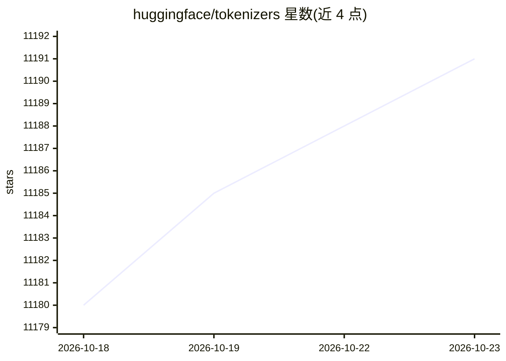

# huggingface/tokenizers

⭐ 11,191 · Rust · Apache-2.0 · 推送 2026-10-22 · [GitHub](https://github.com/huggingface/tokenizers) · [官网](https://huggingface.co/docs/tokenizers) · 组织维护

**面向研究与生产的分词器库，Rust 实现含多语言绑定**

Hugging Face 维护的分词器引擎：Rust 参考实现，提供 Python 与 Node.js 绑定，支持 BPE/Unigram/WordPiece/WordLevel 模型及完整 Normalizer→PreTokenizer→Model→PostProcessor→Decoder 管线；可从 Hugging Face Hub 加载预训练分词器（如 Llama-3.1-8B）。v1.0.0 处于发布候选阶段，Python 训练等 API 尚未全部回归；训练与 Hub 下载为 Rust 侧可选 feature。硬件上不要求 SIMD，各内核均有可移植回退路径。

## 筛选速览

| 维度 | 判定 | 备注 |
|---|---|---|
| AI 角色 | `ai-ecosystem` | LLM/agent 周边工具 |
| 许可风险 | `permissive` | Apache-2.0 |
| 部署形态 | `library` | 以包/库形式分发 |
| 模型依赖 | — | README 未给出锁定关系 |
| 硬件要求 | — | 无带数字的原话,不猜 |
| 安装摩擦 | `low` | 无编译、无系统依赖或容器化 |
| 成熟度 | `idea` | |

## 能力要点

- Rust 参考实现，Python/Node.js 绑定可用，C/C++/Java/Go 计划中
- 支持 BPE/Unigram/WordPiece/WordLevel 模型与完整分词管线
- tk-train 训练模块为可选 feature，默认关闭以缩减服务二进制体积
- 无 SIMD 硬性要求，aarch64/x86_64/wasm32 各有优化与标量回退路径

## 适用场景

- 在训练或推理管线中对文本做分词与编码
- 从 Hugging Face Hub 加载已有分词器（如 Llama、GPT 系列）
- 在资源受限环境中按需组合子 crate 构建更小的分词服务

## 场景标签

 · 领域:NLP/LLM 基础设施

## 证据(README 行号)

> L37: >>> tokenizer = Tokenizer.from_pretrained("meta-llama/Llama-3.1-8B")   # or .from_file(path)
> L51: |Rust|✅ reference implementation|

## 星数曲线

2026-10-18 11,180 → 2026-10-23 11,191（+11）

---
*卡片 v1 · prompt 1.4 · 生成 2026-10-20 · 置信度 high · 依据 README sha `8b4aedb4ef1f` · [字段定义](../../DATASET.md)*
