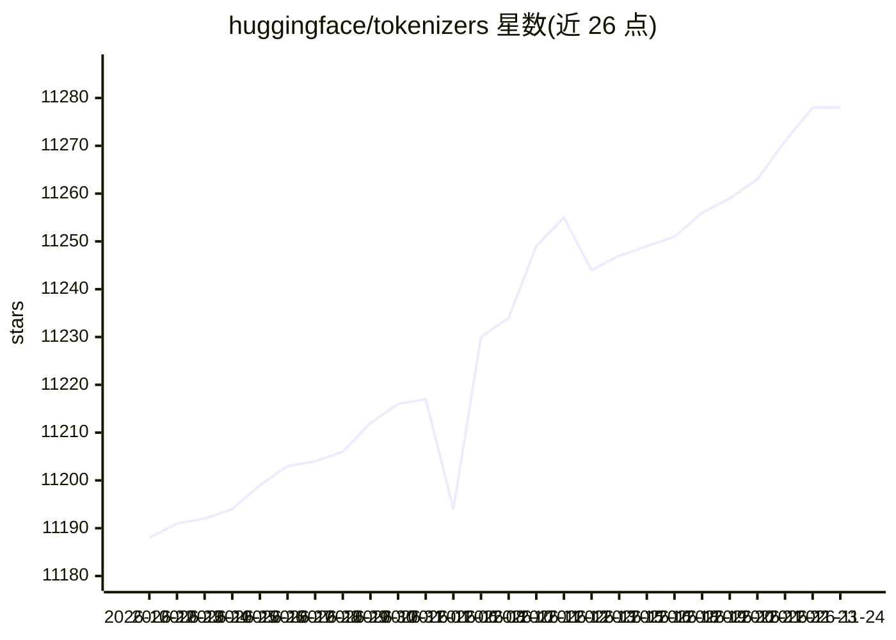

# huggingface/tokenizers

⭐ 11,289 · Rust · Apache-2.0 · 推送 2026-11-23 · [GitHub](https://github.com/huggingface/tokenizers) · [官网](https://huggingface.co/docs/tokenizers) · 组织维护

**为研究与生产环境提供高性能分词器实现的库**

Hugging Face 维护的分词库，目标定位为行业通用的 tokenization 引擎。Rust 为参考实现，提供 Python、Node.js 与 WebAssembly 绑定。支持 BPE、Unigram、WordPiece、WordLevel 模型及 Normalizer/PreTokenizer/PostProcessor/Decoder 全流程；v1.0.0 拆分为 tk-encode 推理、tk-train 训练、tk-serialize 读取、tk-convert 迁移等多个子 crate，训练与推理分离。从 Hub 读取 tokenizer.json 配置，训练与 Hub 下载为 Rust crate 的 opt-in 特性。当前处于 1.0.0 候选阶段，部分 API 尚未回迁。

## 筛选速览

| 维度 | 判定 | 备注 |
|---|---|---|
| AI 角色 | `ai-ecosystem` | LLM/agent 周边工具 |
| 许可风险 | `permissive` | Apache-2.0 |
| 部署形态 | `library` | 以包/库形式分发 |
| 模型依赖 | — | README 未给出锁定关系 |
| 硬件要求 | — | 无带数字的原话,不猜 |
| 安装摩擦 | `low` | 无编译、无系统依赖或容器化 |
| 成熟度 | `idea` | |

## 能力要点

- Rust 参考实现，提供 Python/Node.js/WebAssembly 绑定
- 支持 BPE/Unigram/WordPiece/WordLevel 与完整分词流水线
- 内嵌字节级预分词语法（gpt2、cl100k、o200k、tekken、deepseek、kimi-k2）
- SIMD 非必需，提供可移植标量回退路径，x86_64 运行时检测

## 适用场景

- 为训练或推理加载 Llama 等模型的 tokenizer 配置
- 在生产服务中以低依赖方式集成文本编码/解码
- 在 Web 端通过 wasm 绑定运行分词

## 场景标签

 · 领域:LLM 基础设施/分词

## 证据(README 行号)

> L9: Our goal with `tokenizers` is to develop and maintain the industry's standard tokenization engine, making it the def
> L56: |Rust|✅ reference implementation|
> L115: The models (BPE, Unigram, WordPiece, WordLevel) and the full pipeline: `Normalizer`,

## 星数曲线

2026-10-22 11,188 → 2026-11-24 11,278（+90）

---
*卡片 v1 · prompt 1.4 · 生成 2026-11-22 · 置信度 high · 依据 README sha `777b078553a9` · [字段定义](../../DATASET.md)*
