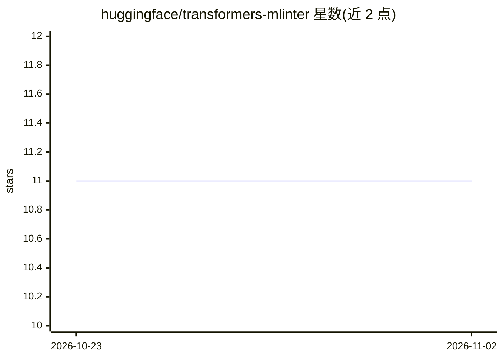

# huggingface/transformers-mlinter

⭐ 11 · Python · Apache-2.0 · 推送 2026-10-28 · [GitHub](https://github.com/huggingface/transformers-mlinter) · [官网](https://huggingface.github.io/transformers-mlinter/) · 组织维护

**给 Transformers 贡献者：静态检查模型集成文件的结构约定**

针对 Hugging Face Transformers 模型集成文件（modeling_/modular_/configuration_/tokenization_ 等）的独立 linter，检查这些文件是否符合维持各模型实现一致性的结构约定。支持全量检查、--changed-only 只查改动、列出与解释单条规则（TRF001 等）、检查 transformers 仓库之外带 trust_remote_code 的模型目录。通过 pip 安装，提供 CLI 与 Python API；文档站点由 rules.toml 生成，含规则忽略指令与贡献流程。

## 筛选速览

| 维度 | 判定 | 备注 |
|---|---|---|
| AI 角色 | `ai-ecosystem` | LLM/agent 周边工具 |
| 许可风险 | `permissive` | Apache-2.0 |
| 部署形态 | `library` | 以包/库形式分发 |
| 模型依赖 | — | README 未给出锁定关系 |
| 硬件要求 | — | 无带数字的原话,不猜 |
| 安装摩擦 | `low` | 无编译、无系统依赖或容器化 |
| 成熟度 | — | 结构信号不足 |

## 能力要点

- 覆盖 modeling/modular/configuration/tokenization 等 9 类模型集成文件
- --changed-only --base-ref 只检查相对基准分支的改动
- 可检查 transformers 仓库外 trust_remote_code 模型目录
- 规则系统带 # trf-ignore、allowlists、cutoff dates 等豁免机制

## 适用场景

- 向 Transformers 提交新模型时检查文件是否符合结构约定
- 维护 Hub 上 trust_remote_code 模型仓库时校验约定
- 代码评审前只对自己改动的文件跑 lint

## 场景标签

 · 领域:软件工程/LLM 生态工具

## 证据(README 行号)

> L6: A standalone linter for Hugging Face Transformers model
> L11: structural conventions that keep hundreds of model implementations consistent with each other.

## 星数曲线

2026-10-23 11 → 2026-11-02 11（+0）

---
*卡片 v1 · prompt 1.4 · 生成 2026-11-02 · 置信度 high · 依据 README sha `264045c63d48` · [字段定义](../../DATASET.md)*
