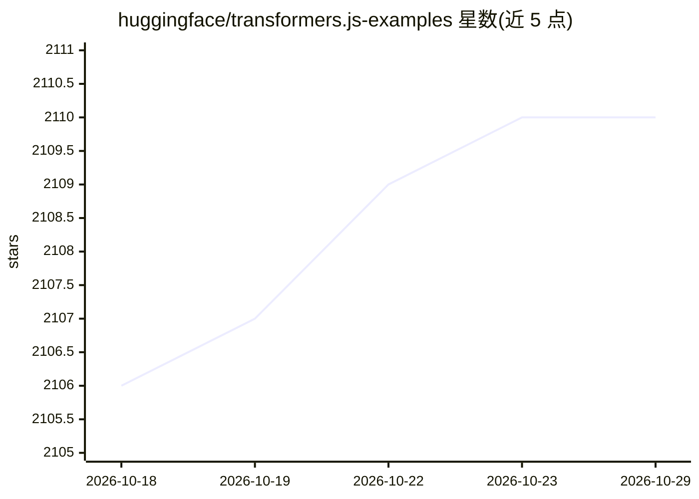

# huggingface/transformers.js-examples

⭐ 2,110 · JavaScript · Apache-2.0 · 推送 2026-02-17 · [GitHub](https://github.com/huggingface/transformers.js-examples) · 组织维护

**Transformers.js 官方示例与演示应用合集**

HuggingFace 维护的 Transformers.js 演示与示例应用集合，覆盖 WebGPU 上的对话 LLM（Phi-3.5、Llama-3.2、SmolLM）、图像分割（Segment Anything、Sapiens）、背景移除、语义搜索，以及 Node.js/Next.js/SvelteKit/Bun/Deno 等多种运行环境的情感分析、文本嵌入示例。每个条目附描述与在线演示链接，并指向 Hugging Face Spaces 上的一键起步模板。面向希望在浏览器或 JS 运行时中集成 Transformers.js 的开发者。

## 筛选速览

| 维度 | 判定 | 备注 |
|---|---|---|
| AI 角色 | `ai-knowledge` | 知识聚合/清单类 |
| 许可风险 | `permissive` | Apache-2.0 |
| 部署形态 | `None` |  |
| 模型依赖 | — | README 未给出锁定关系 |
| 硬件要求 | — | 无带数字的原话,不猜 |
| 安装摩擦 | `low` | 无编译、无系统依赖或容器化 |
| 成熟度 | — | 结构信号不足 |

## 能力要点

- 收录 Phi-3.5/Llama-3.2/SmolLM 等 WebGPU 对话模型演示
- 含图像分割、背景移除、语义搜索、情感分析、文本嵌入示例
- 覆盖 Node.js/Next.js/SvelteKit/Bun/Deno 多运行环境

## 适用场景

- 学习如何在浏览器端运行 LLM 与视觉模型
- 参考不同 JS 运行时（Node/Bun/Deno）集成 Transformers.js 的写法
- 一键使用 Hugging Face 模板快速起步

## 场景标签

`教程课程` · 领域:学习与行业

## 证据(README 行号)

> L3: A collection of 🤗 Transformers.js demos and example applications.
> L5: |Name|Description|Links|

## 星数曲线

2026-10-18 2,106 → 2026-10-29 2,110（+4）

---
*卡片 v1 · prompt 1.4 · 生成 2026-10-21 · 置信度 high · 依据 README sha `25d3d37360c1` · [字段定义](../../DATASET.md)*
