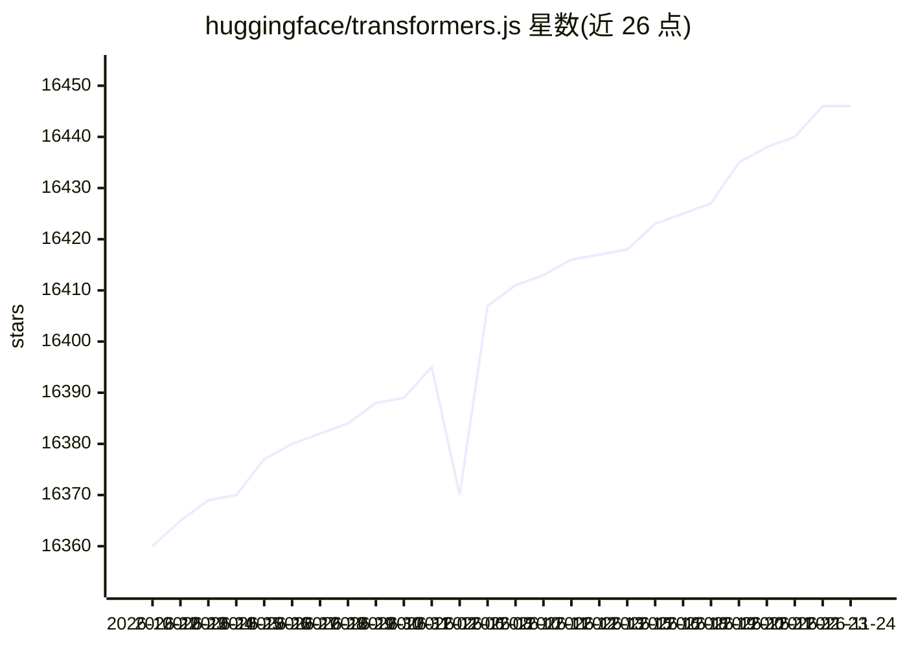

# huggingface/transformers.js

⭐ 16,453 · JavaScript · Apache-2.0 · 推送 2026-11-23 · [GitHub](https://github.com/huggingface/transformers.js) · [官网](https://huggingface.co/docs/transformers.js) · 组织维护

**让 Web 开发者在浏览器中直接运行 Transformers 预训练模型**

Transformers.js 是 Hugging Face transformers Python 库的 JavaScript 实现复古刻，设计为功能等价，提供相同的 pipeline API。它基于 ONNX Runtime 在浏览器中运行预训练模型，无需服务器，支持 NLP、视觉、音频、多模态等任务。模型可从 PyTorch/TensorFlow/JAX 经 Optimum 转为 ONNX。默认通过 WASM 在 CPU 上运行，可切换 WebGPU 在 GPU 上运行；支持 fp32/fp16/q8/q4 量化以降低带宽。默认使用 Hub 托管模型与预编译 WASM 二进制，也支持自定义模型路径。通过 npm 安装或 CDN 直接引入。

## 筛选速览

| 维度 | 判定 | 备注 |
|---|---|---|
| AI 角色 | `ai-native` | 本体是模型或模型工具 |
| 许可风险 | `permissive` | Apache-2.0 |
| 部署形态 | `library` | 以包/库形式分发 |
| 模型依赖 | — | README 未给出锁定关系 |
| 硬件要求 | — | 无带数字的原话,不猜 |
| 安装摩擦 | `low` | 无编译、无系统依赖或容器化 |
| 成熟度 | — | 结构信号不足 |

## 动量与使用信号

- 维护:`active` — 距上次 push 3.1 天,年发版 9,77 位贡献者
- 涨星:近 1 天 **-1**(自 20261016 起算)
- 安装:npm 包 `@huggingface/transformers` 月下载 15,767,003

## 能力要点

- 功能等价于 transformers Python 库的 pipeline API
- 基于 ONNX Runtime，浏览器内运行无需服务器
- 支持 WASM/CPU 与 WebGPU/GPU 两种设备后端
- 支持 fp32/fp16/q8/q4 量化以适配资源受限环境

## 适用场景

- 在网页中直接运行文本分类、问答、翻译等 NLP 模型
- 浏览器内做语音识别或文字转语音
- 前端实现图像分类、目标检测、背景移除等视觉任务
- 用官方模板快速启动自己的 Web ML 项目

## 场景标签

`语音识别` `目标检测` `语音合成` · 领域:内容生成

## 证据(README 行号)

> L13: Transformers.js is designed to be functionally equivalent to Hugging Face's transformers python library, meaning yo
> L19: Transformers.js uses ONNX Runtime to run models in the browser. The best part about it, is that you can easily conv

## 星数曲线

2026-10-22 16,360 → 2026-11-24 16,446（+86）

---
*卡片 v1 · prompt 1.4 · 生成 2026-11-22 · 置信度 high · 依据 README sha `7a4afde5b4f4` · [字段定义](../../DATASET.md)*
