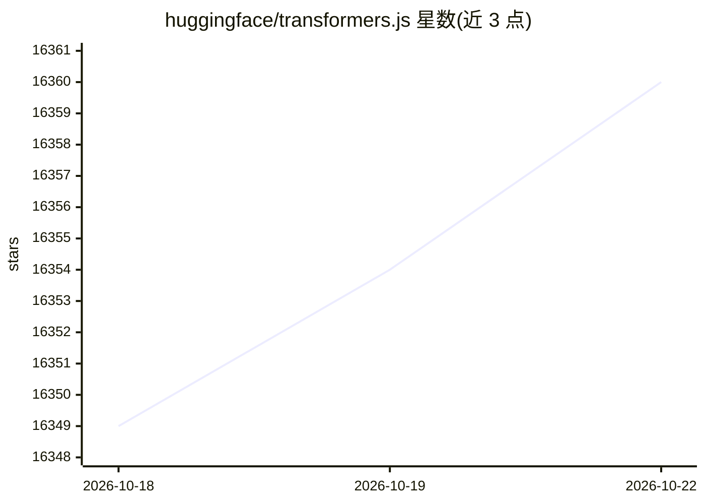

# huggingface/transformers.js

⭐ 16,360 · JavaScript · Apache-2.0 · 推送 2026-10-21 · [GitHub](https://github.com/huggingface/transformers.js) · [官网](https://huggingface.co/docs/transformers.js) · 组织维护

**Web 开发者在浏览器中运行 Transformer 预训练模型的 JS 库**

Transformers.js 是 Hugging Face transformers Python 库在 JavaScript 上的功能等价实现，通过 ONNX Runtime 在浏览器内运行预训练模型，无需服务器。API 与 Python 版一致，提供 pipeline 接口；任务覆盖 NLP、计算机视觉、音频与多模态共数十种。模型默认通过 WASM 在 CPU 上运行，可设置 device: 'webgpu' 切换到 GPU；在浏览器等资源受限环境中可通过 dtype 选项选择 fp32/fp16/q8/q4 量化以降低带宽。经 NPM 安装，也可通过 CDN 直接引入。

## 筛选速览

| 维度 | 判定 | 备注 |
|---|---|---|
| AI 角色 | `ai-native` | 本体是模型或模型工具 |
| 许可风险 | `permissive` | Apache-2.0 |
| 部署形态 | `library` | 以包/库形式分发 |
| 模型依赖 | — | README 未给出锁定关系 |
| 硬件要求 | — | 无带数字的原话,不猜 |
| 安装摩擦 | `low` | 无编译、无系统依赖或容器化 |
| 成熟度 | — | 结构信号不足 |

## 动量与使用信号

- 维护:`active` — 距上次 push 3.1 天,年发版 9,77 位贡献者
- 涨星:近 1 天 **-1**(自 20261016 起算)
- 安装:npm 包 `@huggingface/transformers` 月下载 15,767,003

## 能力要点

- 基于 ONNX Runtime 在浏览器运行预训练模型，无需服务器
- 支持 NLP、视觉、音频、多模态等多类任务（含任务/架构支持清单）
- 默认 WASM/CPU 运行，可配置 WebGPU
- 支持 fp32/fp16/q8/q4 量化以适配资源受限环境

## 适用场景

- 在网页中做文本分类、问答、翻译等 NLP 推理
- 浏览器端图像分类、目标检测与背景移除
- 网页内语音识别与文字转语音
- 将已有 PyTorch 模型经 Optimum 转为 ONNX 后在 Web 上运行

## 场景标签

`推理引擎` · 领域:训练与推理

## 证据(README 行号)

> L11: Run 🤗 Transformers directly in your browser, with no need for a server!
> L13: Transformers.js is designed to be functionally equivalent to Hugging Face's transformers python library, meaning yo
> L19: Transformers.js uses ONNX Runtime to run models in the browser. The best part about it, is that you can easily conv

## 星数曲线

2026-10-18 16,349 → 2026-10-22 16,360（+11）

---
*卡片 v1 · prompt 1.4 · 生成 2026-10-18 · 置信度 high · 依据 README sha `fa5958956746` · [字段定义](../../DATASET.md)*
