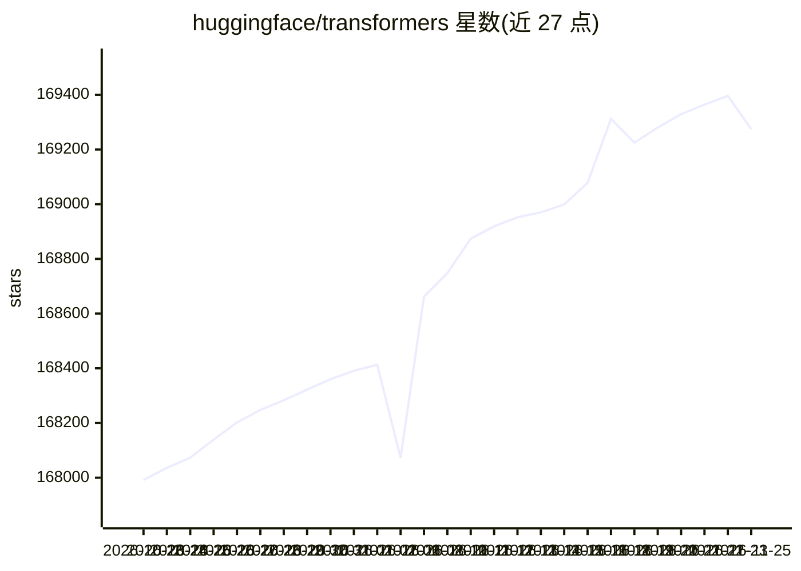

# huggingface/transformers

⭐ 169,274 · Python · Apache-2.0 · 推送 2026-11-24 · [GitHub](https://github.com/huggingface/transformers) · [官网](https://huggingface.co/transformers) · 组织维护

**面向开发者的多模态预训练模型定义与推理训练框架**

transformers 作为模型定义框架，集中维护文本、视觉、音频、视频与多模态模型的统一实现，供推理与训练使用。通过 Pipeline 高层 API 完成预处理与输出，支持 transformers serve/chat 命令行对话。生态中训练框架（Axolotl、DeepSpeed、FSDP 等）与推理引擎（vLLM、SGLang、TGI）复用其模型定义。要求 Python 3.11+ 与 PyTorch 2.6+；训练 API 仅针对其自身提供的 PyTorch 模型优化，通用机器学习循环需使用 Accelerate 等库。Hub 上有 1M+ 可用检查点。

## 筛选速览

| 维度 | 判定 | 备注 |
|---|---|---|
| AI 角色 | `ai-native` | 本体是模型或模型工具 |
| 许可风险 | `permissive` | Apache-2.0 |
| 部署形态 | `library` | 以包/库形式分发 |
| 模型依赖 | local-ok | 支持本地模型 |
| 硬件要求 | — | 无带数字的原话,不猜 |
| 安装摩擦 | `low` | 无编译、无系统依赖或容器化 |
| 成熟度 | — | 结构信号不足 |

## 动量与使用信号

- 维护:`active` — 距上次 push 0.7 天,年发版 45,438 位贡献者
- 涨星:近 1 天 **+33**(自 20261016 起算)

## 能力要点

- 统一 API 定义文本/视觉/音频/视频/多模态模型，支持推理与训练
- Pipeline 高层 API 覆盖文本生成、语音识别、图像分类、视觉问答等任务
- 模型定义被主流训练框架与推理引擎（vLLM、SGLang、llama.cpp 等）复用
- 可在 PyTorch/JAX/TF2.0 之间移动同一模型

## 适用场景

- 几行代码加载预训练模型做文本生成或对话
- 用 Pipeline 处理语音识别、图像分类等多模态任务
- 训练自定义模型并复用社区已有架构
- 为下游训练/推理框架提供一致的模型定义

## 场景标签

`多模态` `模型训练` · 领域:感知与多模态

## 证据(README 行号)

> L35: Transformers acts as the model-definition framework for state-of-the-art machine learning with text, computer
> L86: Get started with Transformers right away with the Pipeline API. The `Pipeline` is a high-level inference class that
> L93: pipeline = pipeline(task="text-generation", model="Qwen/Qwen2.5-1.5B")

## 星数曲线

2026-10-23 167,992 → 2026-11-25 169,274（+1,282）

---
*卡片 v1 · prompt 1.4 · 生成 2026-11-22 · 置信度 high · 依据 README sha `2873f04760b9` · [字段定义](../../DATASET.md)*
