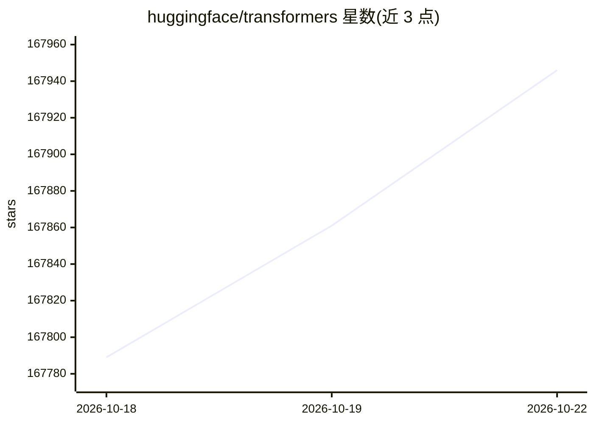

# huggingface/transformers

⭐ 167,992 · Python · Apache-2.0 · 推送 2026-10-22 · [GitHub](https://github.com/huggingface/transformers) · [官网](https://huggingface.co/transformers) · 组织维护

**为文本/视觉/音频/多模态模型提供统一模型定义，用于推理与训练**

Hugging Face 的 Transformers 库作为模型定义框架，集中维护各模态预训练模型的定义，使其可被 Axolotl、DeepSpeed 等训练框架与 vLLM、TGI 等推理引擎复用。提供 Pipeline 高层推理 API，覆盖文本生成、语音识别、图像分类、视觉问答等任务，模型从 Hub 下载并缓存。要求 Python 3.10+ 与 PyTorch 2.6+，可通过 pip/uv 安装或从源码构建；Hub 上有 1M+ 模型检查点可用，另提供 transformers chat 命令行对话与 serve 本地服务。

## 筛选速览

| 维度 | 判定 | 备注 |
|---|---|---|
| AI 角色 | `ai-ecosystem` | LLM/agent 周边工具 |
| 许可风险 | `permissive` | Apache-2.0 |
| 部署形态 | `library` | 以包/库形式分发 |
| 模型依赖 | — | README 未给出锁定关系 |
| 硬件要求 | — | 无带数字的原话,不猜 |
| 安装摩擦 | `low` | 无编译、无系统依赖或容器化 |
| 成熟度 | — | 结构信号不足 |

## 动量与使用信号

- 维护:`active` — 距上次 push 0.7 天,年发版 45,438 位贡献者
- 涨星:近 1 天 **+33**(自 20261016 起算)

## 能力要点

- 统一模型定义框架，兼容主流训练框架与推理引擎
- Pipeline API 覆盖文本、音频、视觉、多模态任务
- Hub 上 1M+ 预训练模型检查点可直接调用
- 同一模型可在 PyTorch/JAX/TF2.0 之间切换

## 适用场景

- 加载预训练模型做文本生成、语音识别或图像分类
- 统一管理各模态模型的定义供训练/推理框架复用
- 通过 transformers chat 在命令行直接与模型对话

## 场景标签

`多模态` `推理引擎` `模型训练` `微调` · 领域:感知与多模态

## 证据(README 行号)

> L34: Transformers acts as the model-definition framework for state-of-the-art machine learning with text, computer
> L85: Get started with Transformers right away with the Pipeline API. The `Pipeline` is a high-level inference class that
> L51: Transformers works with Python 3.10+, and PyTorch 2.6+.

## 星数曲线

2026-10-18 167,789 → 2026-10-22 167,946（+157）

---
*卡片 v1 · prompt 1.4 · 生成 2026-10-18 · 置信度 high · 依据 README sha `f91279f14c04` · [字段定义](../../DATASET.md)*
