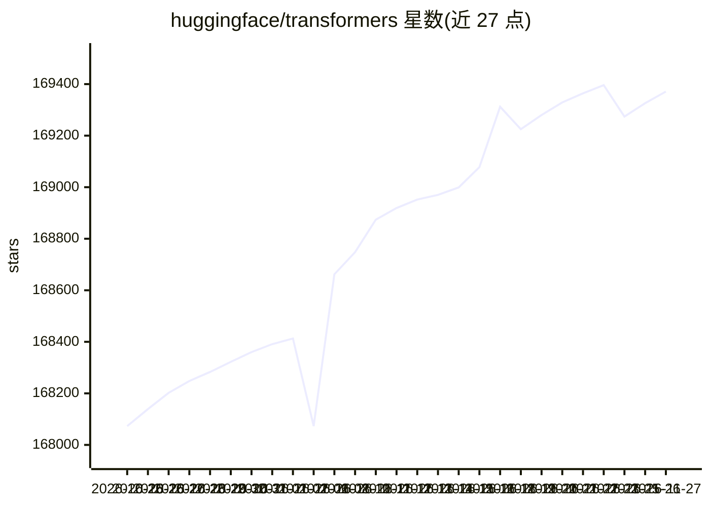

# huggingface/transformers

⭐ 169,371 · Python · Apache-2.0 · 推送 2026-11-26 · [GitHub](https://github.com/huggingface/transformers) · [官网](https://huggingface.co/transformers) · 组织维护 · 中文 README

**ML 模型定义框架：为文本/视觉/音频/多模态模型提供统一的推理与训练定义**

Transformers 将机器学习模型以 PyTorch 统一定义一次，同一份定义同时用于推理与训练；训练框架、推理引擎与本地运行时可基于该定义构建而无需自行实现。每个模型为一个自上而下的单文件，数百个架构共享同一结构，新架构发布后即被添加并与原始结果对齐。提供 Pipeline、文本生成、终端聊天（transformers chat）、HTTP 服务（transformers serve，兼容 OpenAI SDK）、Trainer 微调、PEFT/FSDP/张量并行等训练能力，以及量化、预编译 kernel 与注意力后端切换等加速手段。生产级大规模部署需配合外部推理引擎。

## 筛选速览

| 维度 | 判定 | 备注 |
|---|---|---|
| AI 角色 | `ai-ecosystem` | LLM/agent 周边工具 |
| 许可风险 | `permissive` | Apache-2.0 |
| 部署形态 | `library` | 以包/库形式分发 |
| 模型依赖 | — | README 未给出锁定关系 |
| 硬件要求 | — | 无带数字的原话,不猜 |
| 安装摩擦 | `low` | 无编译、无系统依赖或容器化 |
| 成熟度 | — | 结构信号不足 |

## 动量与使用信号

- 维护:`active` — 距上次 push 0.7 天,年发版 45,438 位贡献者
- 涨星:近 1 天 **+33**(自 20261016 起算)

## 能力要点

- 模型单文件定义，一次定义同时支持推理与训练
- transformers serve 提供 OpenAI SDK 兼容的本地 HTTP 服务
- Trainer/PEFT/FSDP/张量并行/专家并行等训练与微调机制
- 可注册自定义 attention/experts 函数或从 Hub 加载优化 kernel

## 适用场景

- 加载 Hub 上的预训练模型做文本、图像、音频、视频推理
- 在单 GPU 或多 GPU 上微调模型
- 通过 OpenAI SDK 兼容接口向应用提供模型服务
- 为新发布的模型架构添加实现

## 场景标签

`微调` · 领域:训练与推理

## 证据(README 行号)

> L35: Transformers is the model-definition framework for machine learning models in text, computer vision, audio, video, 
> L37: Training frameworks, inference engines, and local runtimes build on that definition instead of writing their own. T
> L97: Serve a model to other applications over HTTP. `transformers serve` is for evaluation, experimentation, and moderat

## 星数曲线

2026-10-25 168,073 → 2026-11-27 169,371（+1,298）

---
*卡片 v1 · prompt 1.4 · 生成 2026-11-26 · 置信度 high · 依据 README sha `621838d95778` · [字段定义](../../DATASET.md)*
