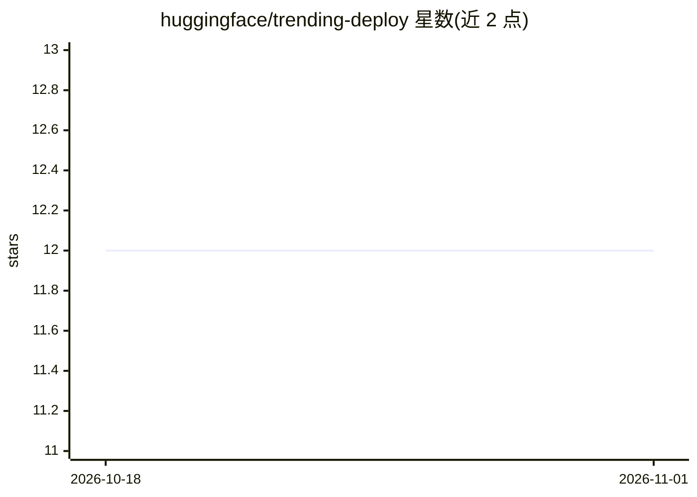

# huggingface/trending-deploy

⭐ 12 · Python · 推送 2026-10-13 · [GitHub](https://github.com/huggingface/trending-deploy) · 组织维护

**在预算内挑选最优模型子集部署的 0/1 背包优化工具**

Hugging Face 维护的部署决策工具：给定一组带趋势分数（trending scores）与托管成本的 ML 模型，在限定预算（背包容量）下求解 0/1 背包问题，选出总奖励最大的部署子集。奖励来自模型趋势分数与任务乘数（可从 API 读取每任务 top n 模型），成本由模型大小映射到硬件开销并取整为整数美元。提供 CLI（cli.py）运行，示例从 4211 个候选模型中选出 389 个、花费 $9,985/$10,000。面向需要规划模型托管的开发者/企业。

## 筛选速览

| 维度 | 判定 | 备注 |
|---|---|---|
| AI 角色 | `ai-ecosystem` | LLM/agent 周边工具 |
| 许可风险 | `none` | — |
| 部署形态 | `None` |  |
| 模型依赖 | — | README 未给出锁定关系 |
| 硬件要求 | — | 无带数字的原话,不猜 |
| 安装摩擦 | `low` | 无编译、无系统依赖或容器化 |
| 成熟度 | — | 结构信号不足 |

## 能力要点

- 0/1 背包求解在预算内最大化趋势分数×任务乘数总奖励
- 从 API 采集每任务 top n 趋势模型及其大小
- 模型大小到硬件成本（整数美元/月）的映射函数
- CLI 支持 --budget/--max-models-per-task/--dry 等参数

## 适用场景

- 托管平台在固定预算内挑选值得部署的模型集合
- 按任务热度权衡模型上架取舍
- 评估不同预算下的最优部署方案

## 场景标签

 · 领域:MLOps/模型部署优化

## 证据(README 行号)

> L2: Given a set of Machine Learning models with trending scores and hosting costs, determine the optimal subset of model
> L12: **Goal:** Solve the 0/1 Knapsack optimization problem to maximize total reward while staying within the budget.

## 星数曲线

2026-10-18 12 → 2026-11-01 12（+0）

---
*卡片 v1 · prompt 1.4 · 生成 2026-11-01 · 置信度 mid · 依据 README sha `391049563b1c` · [字段定义](../../DATASET.md)*
