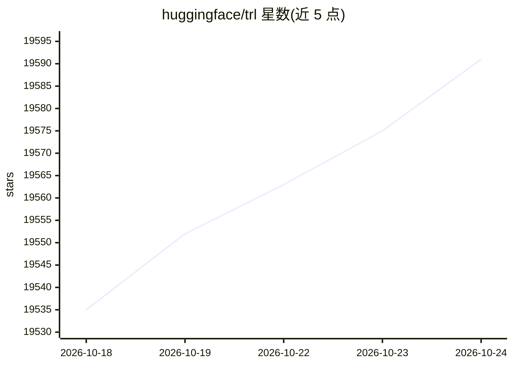

# huggingface/trl

⭐ 19,596 · Python · Apache-2.0 · 推送 2026-10-24 · [GitHub](https://github.com/huggingface/trl) · [官网](http://hf.co/docs/trl) · 组织维护

**为开发者提供基础模型后训练（SFT/DPO/GRPO 等）的库**

构建于 Transformers 之上的基础模型后训练库，通过 SFTTrainer、GRPOTrainer、DPOTrainer、KTOTrainer、RewardTrainer 等 trainer 提供 SFT、GRPO、DPO、KTO 等训练方法；基于 Accelerate 支持从单卡到多节点集群的 DDP/DeepSpeed/FSDP 分布式训练，配合 PEFT 通过量化与 LoRA/QLoRA 在有限硬件上训练大模型，并集成 Unsloth 加速内核。提供无需写代码的 CLI，pip 安装，Apache-2.0 许可。

## 筛选速览

| 维度 | 判定 | 备注 |
|---|---|---|
| AI 角色 | `ai-native` | 本体是模型或模型工具 |
| 许可风险 | `permissive` | Apache-2.0 |
| 部署形态 | `library` | 以包/库形式分发 |
| 模型依赖 | — | README 未给出锁定关系 |
| 硬件要求 | — | 无带数字的原话,不猜 |
| 安装摩擦 | `low` | 无编译、无系统依赖或容器化 |
| 成熟度 | — | 结构信号不足 |

## 动量与使用信号

- 维护:`active` — 距上次 push 1.6 天,年发版 35,465 位贡献者
- 涨星:近 1 天 **+8**(自 20261016 起算)
- 安装:pypi 包 `trl` 月下载 2,540,661

## 能力要点

- 多种训练方法 trainer：SFT、GRPO、DPO、KTO、Reward
- 基于 Accelerate 的 DDP/DeepSpeed/FSDP 分布式训练支持
- 与 PEFT 集成，支持量化与 LoRA/QLoRA
- CLI 无需写代码即可微调模型

## 适用场景

- 在自己的数据集上对语言模型做监督微调
- 用 DPO/GRPO 对模型做偏好对齐后训练
- 在有限硬件上用 LoRA/QLoRA 训练大模型

## 场景标签

`微调` `强化学习` · 领域:训练与推理

## 证据(README 行号)

> L7:  A comprehensive library to post-train foundation models
> L24: TRL is a cutting-edge library designed for post-training foundation models using advanced techniques like Supervise
> L31:  - Leverages 🤗 Accelerate to scale from single GPU to multi-node clusters using methods like DDP and DeepSpeed.

## 星数曲线

2026-10-18 19,535 → 2026-10-24 19,591（+56）

---
*卡片 v1 · prompt 1.4 · 生成 2026-10-18 · 置信度 high · 依据 README sha `c73ac7de96aa` · [字段定义](../../DATASET.md)*
