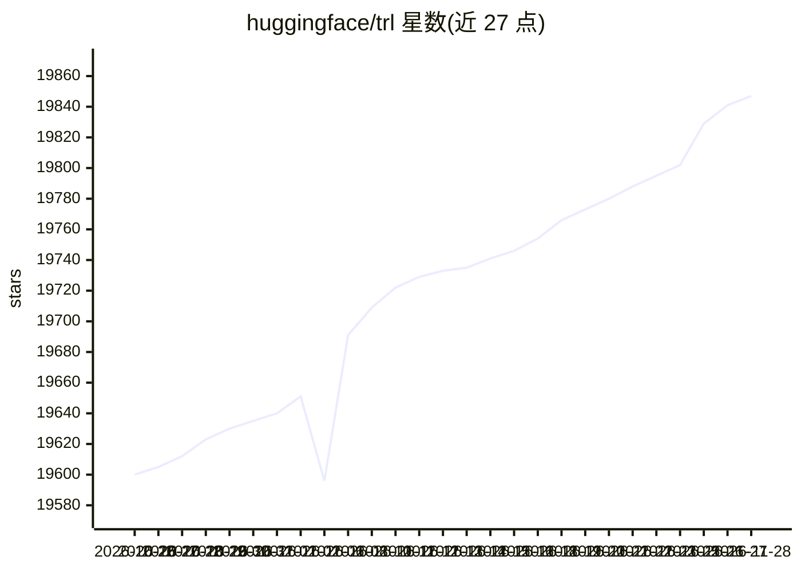

# huggingface/trl

⭐ 19,847 · Python · Apache-2.0 · 推送 2026-11-27 · [GitHub](https://github.com/huggingface/trl) · [官网](http://hf.co/docs/trl) · 组织维护

**面向开发者的基础模型后训练库：支持 SFT/DPO/GRPO 等方法**

构建于 🤗 Transformers 生态之上的后训练库，提供 SFTTrainer、DPOTrainer、GRPOTrainer、KTOTrainer、RewardTrainer 等多种训练器用于微调与对齐语言模型。借助 Accelerate 支持从单卡到多节点集群的 DDP、DeepSpeed、FSDP 分布式训练；与 PEFT 集成支持量化与 LoRA/QLoRA 训练；集成 Unsloth 优化内核加速训练；提供 CLI 无需写代码即可执行 SFT/DPO/KTO。另设 trl.experimental 实验区域存放不稳定特性。以 Python 包形式通过 pip 安装，源码采用 Apache-2.0 许可。

## 筛选速览

| 维度 | 判定 | 备注 |
|---|---|---|
| AI 角色 | `ai-ecosystem` | LLM/agent 周边工具 |
| 许可风险 | `permissive` | Apache-2.0 |
| 部署形态 | `library` | 以包/库形式分发 |
| 模型依赖 | local-ok | 支持本地模型 |
| 硬件要求 | — | 无带数字的原话,不猜 |
| 安装摩擦 | `low` | 无编译、无系统依赖或容器化 |
| 成熟度 | — | 结构信号不足 |

## 动量与使用信号

- 维护:`active` — 距上次 push 1.6 天,年发版 35,465 位贡献者
- 涨星:近 1 天 **+8**(自 20261016 起算)
- 安装:pypi 包 `trl` 月下载 2,540,661

## 能力要点

- 提供 SFT/DPO/GRPO/KTO/Reward 等多种后训练 trainer
- 支持 DDP、DeepSpeed ZeRO、FSDP 分布式训练，可扩展至多节点
- CLI 无需写代码即可执行 SFT/DPO/KTO 微调
- AsyncGRPOTrainer 用 vLLM 服务器生成 rollout，与训练重叠执行

## 适用场景

- 对自定义数据集做监督微调训练自己的模型
- 用偏好数据做 DPO/KTO 对齐训练
- 用 GRPO 强化学习方法后训练推理模型
- 在资源有限硬件上用 LoRA/QLoRA 微调大模型

## 场景标签

`微调` `强化学习` · 领域:训练与推理

## 证据(README 行号)

> L7:  A comprehensive library to post-train foundation models
> L20: TRL is a cutting-edge library designed for post-training foundation models using advanced techniques like Supervise
> L31: - **Command Line Interface (CLI)**: A simple interface lets you fine-tune with models without needing to write code

## 星数曲线

2026-10-26 19,600 → 2026-11-28 19,847（+247）

---
*卡片 v1 · prompt 1.4 · 生成 2026-11-22 · 置信度 high · 依据 README sha `491c4547dde9` · [字段定义](../../DATASET.md)*
