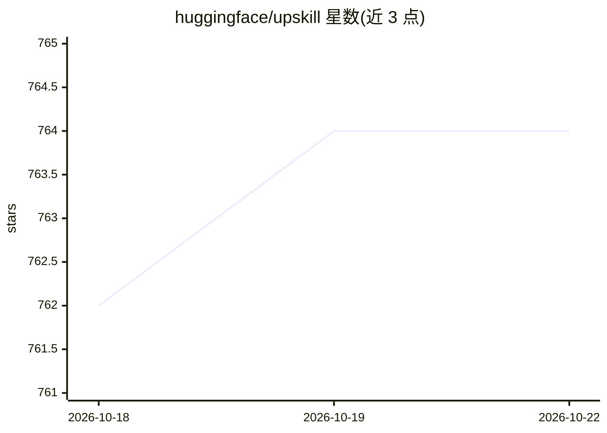

# huggingface/upskill

⭐ 764 · Python · Apache-2.0 · 推送 2026-10-14 · [GitHub](https://github.com/huggingface/upskill) · 组织维护

**为代码 agent 生成并评测 SKILL.md 技能的 CLI 工具**

Hugging Face 维护的 Python CLI：从任务描述或既有 agent 轨迹生成 SKILL.md 技能（含 references/scripts 目录），用教学模型生成与提炼技能、学生模型执行评测，支持基线对比、多模型多次运行的基准测试、结果绘图与 CSV 导出。评测可经本地执行或 HF Jobs 远程执行，模型接入采用 FastAgent 格式，支持 Anthropic/OpenAI 及任意 OpenAI 兼容端点（llama.cpp、vLLM、Ollama）。技能面向 Claude Code、Codex 等代码 agent 使用。

## 筛选速览

| 维度 | 判定 | 备注 |
|---|---|---|
| AI 角色 | `ai-ecosystem` | LLM/agent 周边工具 |
| 许可风险 | `permissive` | Apache-2.0 |
| 部署形态 | `library` | 以包/库形式分发 |
| 模型依赖 | local-ok | 支持本地模型 |
| 硬件要求 | — | 无带数字的原话,不猜 |
| 安装摩擦 | `low` | 无编译、无系统依赖或容器化 |
| 成熟度 | — | 结构信号不足 |

## 能力要点

- 教师模型生成技能、学生模型执行评测的分工机制
- 多模型多次运行的基准测试与基线对比
- 评测任务可运行在本地或 Hugging Face Jobs 远程执行器
- 兼容任意 OpenAI 兼容端点的本地模型（llama.cpp/vLLM/Ollama）

## 适用场景

- 把昂贵模型的操作经验沉淀为廉价模型可复用的技能文件
- 对已有技能做多模型基准测试，量化技能带来的提升
- 从历史 agent 轨迹提炼并迭代技能文档

## 场景标签

`模型评测` `提示工程` · 领域:Agent 开发

## 证据(README 行号)

> L5: Generate and evaluate agent skills based on traces with agents. Create skills with teacher models (expensive/slow) t
> L99: upskill uses distinct phases with explicit model roles:
> L169: Evaluate an existing skill against test cases. Supports single-model evaluation with baseline comparison, or multi

## 星数曲线

2026-10-18 762 → 2026-10-22 764（+2）

---
*卡片 v1 · prompt 1.4 · 生成 2026-10-21 · 置信度 high · 依据 README sha `452bc73f2080` · [字段定义](../../DATASET.md)*
