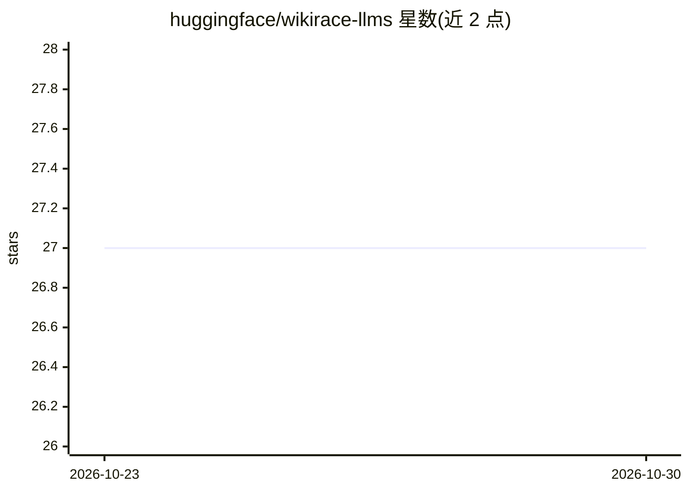

# huggingface/wikirace-llms

⭐ 27 · TypeScript · 推送 2026-10-22 · [GitHub](https://github.com/huggingface/wikirace-llms) · 组织维护

**与 LLM 竞速 Wikirace 的 Hugging Face Space 演示**

Hugging Face 官方仓库的互动演示：用户在维基百科链接图中与 Qwen、Gemma、DeepSeek 等模型进行 Wikirace 对战，看谁更快从起始词条到达目标词条；也可在任意模型上并行运行上百个 agent 做评测。以 Docker SDK 的 Space 形式提供（端口 7860），使用 hf_oauth 与 inference-api 权限，需 Hugging Face 登录访问。

## 筛选速览

| 维度 | 判定 | 备注 |
|---|---|---|
| AI 角色 | `ai-native` | 本体是模型或模型工具 |
| 许可风险 | `none` | — |
| 部署形态 | `None` |  |
| 模型依赖 | — | README 未给出锁定关系 |
| 硬件要求 | — | 无带数字的原话,不猜 |
| 安装摩擦 | `low` | 无编译、无系统依赖或容器化 |
| 成熟度 | — | 结构信号不足 |

## 能力要点

- 人机对抗的 Wikirace 互动演示（Qwen/Gemma/DeepSeek）
- 支持在任意模型上并行运行上百个 agent 做评测
- Docker Space 部署，使用 inference-api OAuth 权限

## 适用场景

- 在浏览器中与 LLM 进行 Wikirace 对战
- 并行运行多个 agent 评估模型的导航能力

## 场景标签

`模型评测` · 领域:评测与运维

## 证据(README 行号)

> L14: Go head-to-head with Qwen, Gemma, and DeepSeek on the Huggingface Space
> L18: Or run 100s of agents on any model in parallel for efficient evaluations see README

## 星数曲线

2026-10-23 27 → 2026-10-30 27（+0）

---
*卡片 v1 · prompt 1.4 · 生成 2026-10-26 · 置信度 high · 依据 README sha `e1a120335562` · [字段定义](../../DATASET.md)*
