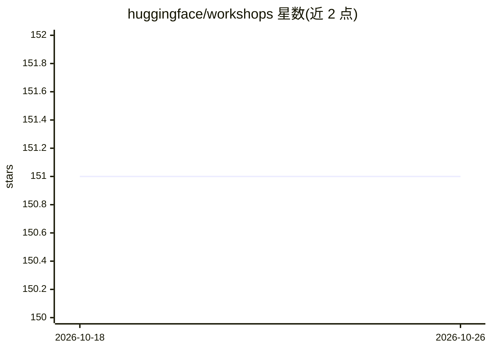

# huggingface/workshops

⭐ 151 · Jupyter Notebook · Apache-2.0 · 推送 2026-09-23 · [GitHub](https://github.com/huggingface/workshops) · 组织维护

**Hugging Face 生态工作坊教学材料仓库**

由 Hugging Face 维护的工作坊（workshop）材料集合，内容围绕 Hugging Face 生态展开，供参加或组织工作坊学习生态各组件使用。README 极简，仅说明仓库用途，未列出具体课程目录、安装步骤或依赖要求；具体材料需查阅仓库内各目录。以教学知识材料形式提供，非可安装运行的软件产品。

## 筛选速览

| 维度 | 判定 | 备注 |
|---|---|---|
| AI 角色 | `ai-knowledge` | 知识聚合/清单类 |
| 许可风险 | `permissive` | Apache-2.0 |
| 部署形态 | `None` |  |
| 模型依赖 | — | README 未给出锁定关系 |
| 硬件要求 | — | 无带数字的原话,不猜 |
| 安装摩擦 | `low` | 无编译、无系统依赖或容器化 |
| 成熟度 | — | 结构信号不足 |

## 能力要点

- Hugging Face 官方维护的工作shop 材料集合
- 主题覆盖 Hugging Face 生态各组件

## 适用场景

- 学习 Hugging Face 生态各组件的入门材料
- 组织或复用 HF 生态工作坊内容

## 场景标签

`教程课程` · 领域:学习与行业

## 证据(README 行号)

> L3: Materials for workshops on the Hugging Face ecosystem

## 星数曲线

2026-10-18 151 → 2026-10-26 151（+0）

---
*卡片 v1 · prompt 1.4 · 生成 2026-10-22 · 置信度 mid · 依据 README sha `eeb964d5083e` · [字段定义](../../DATASET.md)*
