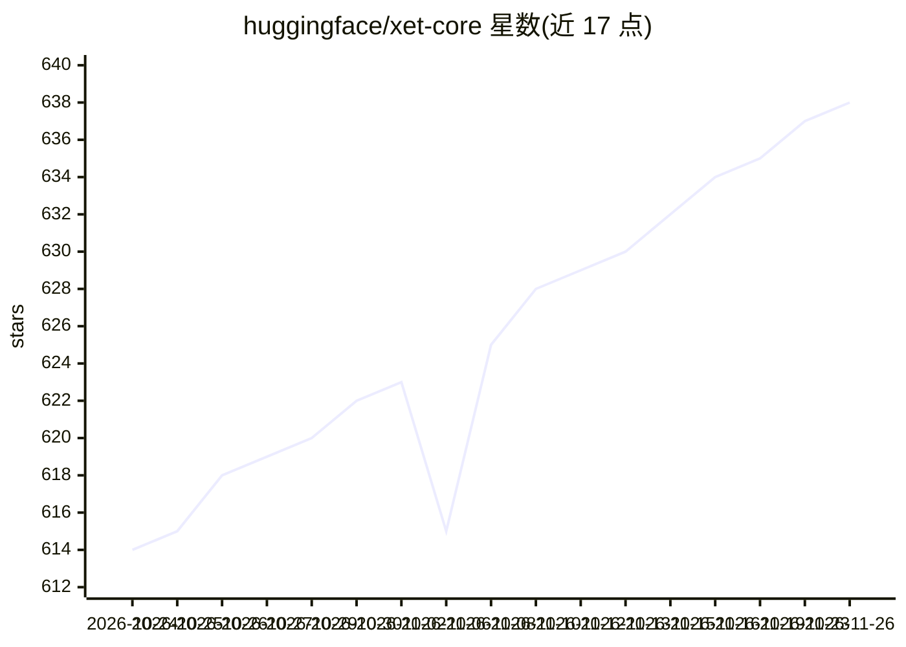

# huggingface/xet-core

⭐ 638 · Rust · Apache-2.0 · 推送 2026-11-25 · [GitHub](https://github.com/huggingface/xet-core) · 组织维护

**Hugging Face Hub 的 Xet 存储客户端，支撑 hf_hub 上传下载**

xet-core 是被 huggingface_hub 使用的 Xet 存储客户端库，使 huggingface_hub 通过 Xet 存储进行 HF Hub 的文件上传与下载。机制包括基于块的去重（避免传输重复数据块）、本地磁盘缓存、与 Git LFS 的向后兼容，以及与 HF Hub Xet 后端（CAS）的并发网络通信。仓库产出 Rust crates、Python 绑定（PyPI 包 hf-xet）与 git-xet CLI 二进制；README 明确该库不供直接使用，应经由 huggingface_hub 使用。构建需 Rust 工具链（cargo），Python 包用 maturin 构建。

## 筛选速览

| 维度 | 判定 | 备注 |
|---|---|---|
| AI 角色 | `ai-ecosystem` | LLM/agent 周边工具 |
| 许可风险 | `permissive` | Apache-2.0 |
| 部署形态 | `library` | 以包/库形式分发 |
| 模型依赖 | — | README 未给出锁定关系 |
| 硬件要求 | — | 无带数字的原话,不猜 |
| 安装摩擦 | `low` | 无编译、无系统依赖或容器化 |
| 成熟度 | — | 结构信号不足 |

## 能力要点

- 基于块的去重：避免重复传输与存储模型/数据集等二进制文件的共享数据块
- Python 绑定供 huggingface_hub 调用（PyPI 包 hf-xet）
- 与 Git LFS 向后兼容，并提供 git-xet 命令行工具
- 基于块的本地磁盘缓存，与 huggingface_hub 现有缓存并存

## 适用场景

- 使用 huggingface_hub 上传/下载模型与数据集时走 Xet 存储后端
- 需要查看或调试 hf-xet 上传下载行为时使用诊断脚本与环境变量
- 基于 Xet 客户端 crates 做二次开发或浏览器端（wasm）集成

## 场景标签

 · 领域:AI 生态基础设施/存储

## 证据(README 行号)

> L9: xet-core enables huggingface_hub to utilize xet storage for uploading and downloading to HF Hub. Xet storage provide
> L29: |`hf-xet`|High-level client library for uploading and downloading files with chunk-based deduplication|
> L39: |`hf-xet`|Python bindings for the Xet storage system, used by huggingface_hub|

## 星数曲线

2026-10-24 614 → 2026-11-26 638（+24）

---
*卡片 v1 · prompt 1.4 · 生成 2026-11-24 · 置信度 mid · 依据 README sha `e371b6426737` · [字段定义](../../DATASET.md)*
