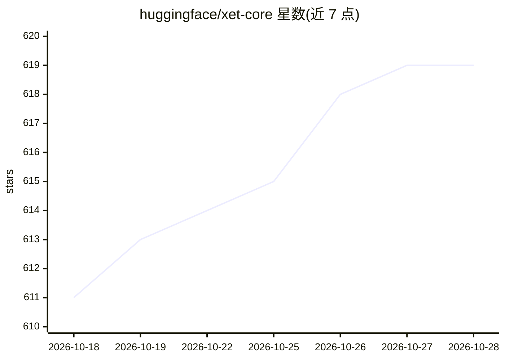

# huggingface/xet-core

⭐ 619 · Rust · Apache-2.0 · 推送 2026-10-27 · [GitHub](https://github.com/huggingface/xet-core) · 组织维护

**为 huggingface_hub 提供 Xet 存储传输的 Rust/Python 客户端技术**

实现 Xet 存储协议的客户端技术栈，使 huggingface_hub 能够以基于块的块级去重方式向 HF Hub 上传和下载模型/数据集文件，并提供本地磁盘缓存、与 Git LFS 的向后兼容。仓库产出多个 Rust crate（hf-xet/xet-client/xet-data 等）、PyPI 包 hf-xet（maturin/PyO3 绑定）及 Git LFS 兼容 CLI git-xet，另有 wasm 构建供浏览器端依赖。声明不供直接使用，而是经 huggingface_hub 调用；遥测为尽力而为、可通过环境变量关闭。

## 筛选速览

| 维度 | 判定 | 备注 |
|---|---|---|
| AI 角色 | `ai-ecosystem` | LLM/agent 周边工具 |
| 许可风险 | `permissive` | Apache-2.0 |
| 部署形态 | `library` | 以包/库形式分发 |
| 模型依赖 | — | README 未给出锁定关系 |
| 硬件要求 | — | 无带数字的原话,不猜 |
| 安装摩擦 | `low` | 无编译、无系统依赖或容器化 |
| 成熟度 | — | 结构信号不足 |

## 能力要点

- 基于 chunk 的去重，避免重复传输/存储共享块
- Python 绑定 hf-xet（PyPI），由 huggingface_hub 调用
- git-xet CLI 与 Git LFS 兼容
- wasm32 目标 CI 强制可编译，供浏览器端依赖

## 适用场景

- 通过 huggingface_hub 上传/下载 HF Hub 模型与数据集
- 以 Git LFS 兼容方式使用 Xet 存储
- 在浏览器端（如 hf-hub）依赖 hf-xet crate 做传输

## 场景标签

 · 领域:AI 模型/数据集存储传输基础设施

## 证据(README 行号)

> L9: xet-core enables huggingface_hub to utilize xet storage for uploading and downloading to HF Hub. Xet storage provide
> L39: |`hf-xet`|Python bindings for the Xet storage system, used by huggingface_hub|

## 星数曲线

2026-10-18 611 → 2026-10-28 619（+8）

---
*卡片 v1 · prompt 1.4 · 生成 2026-10-21 · 置信度 high · 依据 README sha `9517980fcea7` · [字段定义](../../DATASET.md)*
